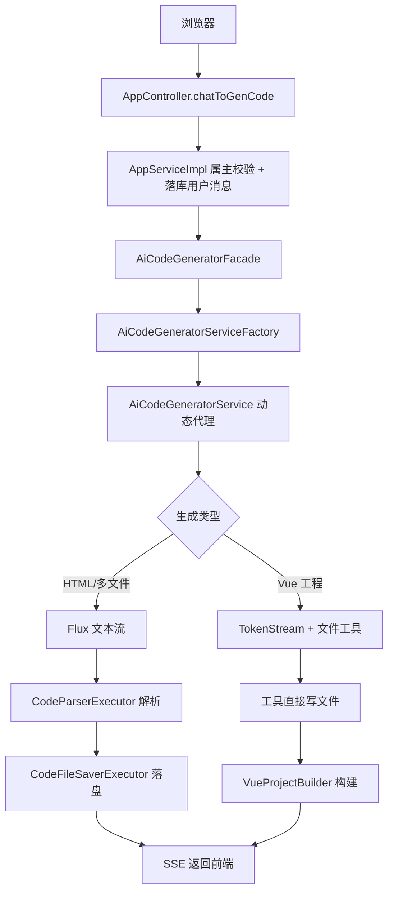

# AI 零代码应用生成项目 · 面试题标准答案（一）

> 格式说明：每题标题为原题号；标题下方依次为「难度 / 方向 / 来源」标签；正文为**推荐答案**，先给结论，再分点展开，复杂机制配流程图。

---

## 12019. 介绍 AI 零代码应用生成项目的后端整体架构，有哪些核心模块，它们之间是如何交互的？

`简单` `后端` `编程导航`

**推荐答案**

项目采用「Controller → Service → 核心生成层 → AI 层」的四层单向依赖架构，核心模块包括用户、应用、对话历史、AI 代码生成、文件解析落盘、工具调用、工作流、截图与监控。

1. **Controller 层**：只负责参数接收、登录态获取和统一响应 `BaseResponse`，不碰 AI 和文件。代表类是 `AppController`、`UserController`。
2. **Service 层**：业务编排与属主校验。比如 `AppServiceImpl.chatToGenCode` 会先校验「这个应用是不是你的」，再**先把用户消息落库**，最后才调用 AI，保证时序和可追溯。
3. **核心生成层**：`AiCodeGeneratorFacade` 统一调度，内部组合 `AiCodeGeneratorServiceFactory`、`CodeParserExecutor`、`CodeFileSaverExecutor`、`VueProjectBuilder`，负责类型分派、解析、落盘和构建。
4. **AI 层**：`AiCodeGeneratorService` 接口 + LangChain4j 动态代理，配合对话记忆、工具、护轨、流式输出和监听器，把大模型能力封装成普通 Bean。
5. **基础设施**：MyBatis-Flex + MySQL 做持久化；Redis 承担 Session、对话记忆、限流和业务缓存；COS 存封面；Selenium 做截图；Micrometer + Prometheus 做监控。

一次生成请求的交互链路：



**设计取舍**：单体分层适合 0 到 1，部署简单、调试链路短；但边界要清晰，依赖必须单向，否则会出现循环依赖和职责泄漏。等用户量和团队规模上来后，再按 user / app / ai / screenshot 拆微服务。

---

## 12020. MyBatis Flex 和 MyBatis Plus 的区别？为什么在项目中选择它？

`简单` `后端` `编程导航`

**推荐答案**

两者都是 MyBatis 的增强 ORM。MyBatis-Flex 更轻量，强调编译期强类型查询；MyBatis-Plus 生态更大、插件更全。项目选择 Flex，是为了「轻量 + 强类型 + 内置逻辑删除和雪花 ID」。

1. **查询方式不同**：Flex 通过 APT 在编译期生成 `TableDef`，字段写错直接编译报错；Plus 的 `LambdaQueryWrapper` 靠运行时反射取字段，错误只能等运行期暴露。
2. **内置能力不同**：Flex 原生支持逻辑删除、多租户、乐观锁、数据填充；Plus 也支持，但更多依赖插件体系，功能更全、体量也更重。
3. **生态不同**：Plus 社区大、教程多、周边插件丰富；Flex 相对小而精，性能更好、依赖更少。
4. **项目中的实际用法**：`@Table("chat_history")` 映射表，`@Id(keyType = KeyType.Generator, value = KeyGenerators.snowFlakeId)` 生成雪花 ID，`@Column(isLogicDelete = true)` 实现逻辑删除，`ServiceImpl<Mapper, Entity>` 加 `QueryWrapper` 完成 CRUD。

**企业落地**：新项目、追求性能和强类型选 Flex；已有大量 Plus 插件（数据权限、动态表名）时，迁移成本高，继续用 Plus 更稳。另外逻辑删除有一个隐性成本：唯一索引必须带上 `isDelete`，否则删除后无法重建同名记录。

---

## 12021. 什么是策略模式？AI 零代码应用生成项目中，你如何使用策略模式处理代码解析逻辑？

`简单` `后端` `编程导航`

**推荐答案**

策略模式是把一组可互换的算法封装成独立类，让调用方按条件选择。项目用 `CodeParser<T>` 接口 + 两个实现 + `CodeParserExecutor` 分派，把 HTML 和多文件的解析差异隔离开。

1. **策略接口**：`CodeParser<T>` 定义 `T parse(String codeContent)`，泛型让「同一种解析动作」可以输出不同类型的结果对象。
2. **具体策略**：`HtmlCodeParser` 用正则从模型输出里抠 ````html```` 代码块，返回 `HtmlCodeResult`；`MultiFileCodeParser` 分别抠 html、css、javascript 三个代码块，返回 `MultiFileCodeResult`。
3. **上下文/分派器**：`CodeParserExecutor` 按 `CodeGenTypeEnum` 选择策略，`default` 分支显式抛业务异常。
4. **为什么这样写**：新增生成类型时只加一个实现类和一个 case，符合开闭原则；解析细节与业务流程解耦；`default` 抛异常可以避免「新增枚举却忘补分支」时静默用错解析器，生成残缺文件还不报错。

**企业落地**：小项目用 if/else 更快；只有分支会持续增长、且每个分支逻辑较重时，策略模式才划算。企业常见进阶是用 `Map<Type, Strategy>` 配合 Spring 的 `List<Strategy>` 自动注入，或者用 SPI 做插件化，再配配置中心实现热插拔。

---

## 12022. 什么是模板方法模式？AI 零代码应用生成项目中，你如何使用模板方法模式处理文件保存逻辑？

`简单` `后端` `编程导航`

**推荐答案**

模板方法模式是父类用 `final` 锁死流程骨架，把可变步骤声明为 `abstract` 交给子类。项目用它统一「校验 → 建目录 → 写文件 → 返回路径」的落盘流程。

1. **父类骨架**：`CodeFileSaverTemplate<T>` 的 `saveCode()` 是 `final`，固定四步：`validateInput` → `buildUniqueDir` → `saveFiles` → 返回目录。
2. **可变部分**：`saveFiles` 和 `getCodeType` 是抽象方法，由 `HtmlCodeFileSaverTemplate` 和 `MultiFileCodeFileSaverTemplate` 各自实现；`validateInput` 是可选覆盖的钩子。
3. **分派器**：`CodeFileSaverExecutor` 按生成类型选择具体保存器。
4. **为什么 `final` 很重要**：流程顺序是不变式，任何子类都不该改；如果开放覆盖，可能出现「先写文件后建目录」或者漏掉校验。`abstract` 只暴露真正会变的部分，符合「封装不变、暴露可变」。

**企业落地**：模板方法适合步骤固定、细节可变的流程，比如导入导出、支付回调、审批流。代价是继承耦合；如果步骤组合更复杂，可以用「组合 + 责任链」替代继承。企业里更常见的是提供 before/after 钩子，而不是让子类覆盖主流程。

---

## 12023. 为什么基于 Selenium 实现浏览器自动化操作时，建议搭配 WebDriverManager 使用？什么是 WebDriver？

`简单` `后端` `编程导航`

**推荐答案**

WebDriver 是代码控制浏览器的 W3C 标准协议和 Java 接口，ChromeDriver 是它在 Chrome 上的实现；WebDriverManager 负责自动下载并匹配浏览器版本的驱动，免去手动装驱动和版本对不上的问题。

1. **三个角色**：Chrome 负责真实渲染；ChromeDriver 作为驱动可执行程序，接收 WebDriver 协议命令并操作浏览器；WebDriver 是开发者面向编程的接口。
2. **没有 WebDriverManager 的痛点**：要手动下载 chromedriver；Chrome 自动升级后驱动版本不匹配，直接报 `session not created`；多环境还要分别维护驱动路径。
3. **项目中的用法**：`WebDriverManager.chromedriver().setup()` 自动解析驱动版本，再构建 `ChromeOptions`，加 `--headless`、`--disable-gpu`、`--no-sandbox`、`--disable-dev-shm-usage`。其中 `--no-sandbox` 是 Docker/root 环境必需，`--disable-dev-shm-usage` 避免容器 `/dev/shm` 过小导致崩溃。
4. **为什么不用普通 HTTP 请求截图**：Selenium 会执行 JS、加载 CSS、完成布局后再截图，Vue 这类动态页面也能截到最终画面。

**企业落地**：WebDriverManager 解决版本匹配，但生产环境更推荐固定浏览器镜像（如 `selenium/standalone-chrome`），避免运行时下载外网依赖。Selenium 偏重、启动慢，截图场景也可以换 Playwright、云截图 API 或独立截图服务。

---

## 12024. AI 零代码应用生成项目中，你是如何实现集中式工具管理的？

`简单` `后端` `编程导航`

**推荐答案**

用「抽象基类定义工具元信息 + Spring 注入 `List<BaseTool>` 自动收集 + `ToolManager` 用 `@PostConstruct` 建名字索引 + `AiServices.tools(...)` 一次性注册」四步，做到新增工具零改动。

1. **统一元信息**：`BaseTool` 规定每个工具必须提供 `getToolName`、`getDisplayName`、`generateToolRequestResponse`、`generateToolExecutedResult`，让流式输出和前端展示不写死工具名。
2. **自动收集**：`ToolManager` 用 `@Resource private List<BaseTool> tools` 注入所有实现，新增工具只要加 `@Component`。
3. **集中注册**：`@PostConstruct` 里遍历建 `Map<String, BaseTool>`，同时提供 `getTool(name)` 给流式处理器按名取工具、`getAllTools()` 给工厂注册。
4. **装配入口**：`AiCodeGeneratorServiceFactory` 在 Vue 分支里 `.tools(toolManager.getAllTools())`，工具只对需要工具调用的模式开放。

**企业落地**：工具多了以后要加权限、超时、重试、审计和开关，可以在 `ToolManager` 外包一层装饰器，或者把模板逻辑放进工具基类。企业还常做「按 Agent/场景分组授权」，避免所有工具对模型全量可见，本项目目前就是全量注册，粒度较粗。

---

## 12025. 项目支持多种 AI 代码生成模式，从架构层面是如何设计和隔离不同模式的生成逻辑的？

`简单` `后端` `编程导航`

**推荐答案**

以 `CodeGenTypeEnum` 作为唯一主键，在「AI 服务装配、流式处理、解析、落盘、构建、缓存键」六个切面分别用 switch 或策略隔离，做到「一处枚举、六处分派」。

| 切面 | 隔离方式 |
|---|---|
| AI 服务装配 | Vue 用推理模型 + 工具 + `chatMemoryProvider`；HTML/多文件用普通流式模型 + `chatMemory` |
| 流式处理 | HTML/多文件返回 `Flux<String>`；Vue 返回 `TokenStream` 再桥接成 Flux |
| 解析 | `HtmlCodeParser` / `MultiFileCodeParser` |
| 落盘 | `HtmlCodeFileSaverTemplate` / `MultiFileCodeFileSaverTemplate` |
| 构建 | Vue 额外执行 `npm install` 和 `npm run build` |
| 缓存键 | `appId + "_" + codeGenType` |

1. **模型能力需求不同**：Vue 要工具调用和推理，HTML 只要文本生成，混在一起会互相污染配置。
2. **产物形态不同**：单文件、多文件、完整工程，解析和落盘规则完全不同。
3. **缓存键必须带类型**：否则同一 appId 的 HTML 和 Vue 会共用 AI 服务实例和记忆，串上下文。

**企业落地**：枚举分派适合类型稳定、分支有限的场景；如果生成类型会动态增加，应该改成「注册表 + 配置驱动」，甚至把提示词、解析器、保存器打成插件包。企业还会有一层能力矩阵：类型对应模型、工具集、配额和计费。

---

## 12026. 如何为不同的 AI 代码生成模式设计和优化系统提示词？有哪些技巧？

`简单` `后端` `编程导航`

**推荐答案**

按模式拆成独立提示词文件，每个文件只负责一件事，并让提示词与「输出格式、解析正则、POJO 字段」形成强绑定契约。

1. **按模式拆分**：`codegen-html-system-prompt.txt` 只输出一个 html 代码块；`codegen-multi-file-system-prompt.txt` 输出 html/css/javascript 三个代码块；`codegen-vue-project-system-prompt.txt` 规定项目结构并强制用工具写文件；`codegen-routing-system-prompt.txt` 只输出枚举值。
2. **四段式结构**：角色（资深前端）+ 任务 + 硬约束（代码块数量、文件路径）+ 输出格式示例。
3. **一个提示词只做一件事**：路由提示词只做分类，配合 `max-tokens: 100` 压成本和延迟。
4. **负向约束要明确**：比如「一定不能输出超过 1 个代码块，否则会导致保存错误」，把下游失败原因直接写进提示词。
5. **提示词与解析器同步演进**：多文件解析依赖 ````html````、````css````、````javascript```` 围栏名，改提示词围栏就必须同步改正则，否则解析静默失败。
6. **外置 + 可版本化**：用 `@SystemMessage(fromResource = "...txt")`，改提示词不用改 Java 代码，便于 diff 和灰度。

**企业落地**：提示词是可运营资产，企业会做版本管理、A/B 测试和线上效果回流。单靠提示词约束格式不够稳，通常会叠加结构化输出和输出校验重试。提示词过长会增加 token 成本和首字延迟，需要在约束完备与长度之间取舍。

---

## 12027. LangChain4j 在项目中有什么作用？你是如何将 AI 大模型能力集成到业务代码中的？

`简单` `后端` `编程导航`

**推荐答案**

LangChain4j 是 Java 侧的大模型应用框架。项目用它把「模型调用、记忆、工具、护轨、流式输出、结构化解析」封装成接口加注解，业务层像调用普通 Bean 一样使用。

1. **AiServices 动态代理**：接口没有实现类，运行时生成实现，方法签名就是调用契约。
2. **提示词与参数绑定**：`@SystemMessage(fromResource = "...txt")` 指定系统提示词，`@UserMessage` 绑定用户消息，`@MemoryId` 定位对话记忆。
3. **记忆**：`MessageWindowChatMemory` + `RedisChatMemoryStore`，最多保留 20 条，实例创建时从 MySQL 回填。
4. **工具**：`@Tool`、`@P`、`@ToolMemoryId` 定义文件操作，工厂用 `.tools(...)` 注册，并配 `maxSequentialToolsInvocations` 和幻觉工具名策略。
5. **护轨**：输入护轨在模型调用前拦截恶意 Prompt，输出护轨做校验重试。
6. **流式与可观测**：返回 `Flux<String>` 或 `TokenStream`，并用 `ChatModelListener` 记录请求、响应、错误。

集成步骤：定义接口 → 工厂用 `AiServices.builder` 组装模型、记忆、工具、护轨 → 业务层注入接口调用 → 模型配置放 `application.yml`。

**企业落地**：框架封装度高、开发快，但出问题偏黑盒，企业会补请求日志、链路追踪和模型网关。LangChain4j 与 Spring AI 是两条路线，前者工具、护轨、记忆抽象更完整，后者更贴 Spring 官方生态。

---

## 12028. 如何实现将 AI 大模型的输出稳定地转换为结构化对象？

`简单` `后端` `编程导航`

**推荐答案**

用「POJO 字段 + `@Description` 字段说明 + 系统提示词输出格式 + 正则解析兜底」四重契约，把不可控的文本输出收敛成可控的 Java 对象。

1. **POJO 定义结构**：`HtmlCodeResult` 有 `htmlCode` 和 `description`，`MultiFileCodeResult` 有 `htmlCode`、`cssCode`、`jsCode`。
2. **`@Description` 向模型解释字段**：框架会把字段描述带进提示词，降低模型输出字段名不一致的概率。
3. **系统提示词约束格式**：明确代码块数量、围栏名称和 JSON 结构。
4. **解析器兜底**：即使模型多说了一句解释，正则仍能抠出代码块；解析失败抛业务异常，而不是返回残缺对象。
5. **参数与重试**：`temperature` 调低减少格式漂移，`max-tokens` 足够大避免截断，`max-retries: 3` 兜底。
6. **契约同步**：改 POJO 字段、提示词、正则任意一处，必须同步另外两处。

**企业落地**：最稳的是模型原生结构化输出（JSON Schema、Function Calling、JSON Mode），由模型保证格式，代价是绑定厂商能力。项目选择「提示词 + 正则」，可移植性强、可换模型，但严格性不如原生结构化输出。企业常见组合是「原生结构化输出优先 + 解析兜底 + 校验重试 + 人工兜底」。

---

## 12029. 描述一下 AI 大模型生成 Vue 工程项目的过程？

`简单` `后端` `编程导航`

**推荐答案**

Vue 走的是 Agent 工具调用路线：推理模型通过 `TokenStream` 一边思考一边调用文件工具，把工程逐个文件写入 `vue_project_{appId}`，流结束后同步执行 `npm install` 和 `npm run build`，最后预览 `dist/index.html`。

1. **类型路由**：`AiCodeGenTypeRoutingService` 先用便宜模型判定为 `VUE_PROJECT`。
2. **创建应用**：`AppServiceImpl.createApp` 落库拿到 appId。
3. **装配 AI 服务**：工厂的 Vue 分支使用 `deepseek-reasoner` 推理流式模型，注册全部工具，配置 `chatMemoryProvider`、工具幻觉策略、最多 20 次连续工具调用和输入护轨。
4. **生成**：调用 `generateVueProjectCodeStream(appId, prompt)` 拿到 `TokenStream`。
5. **桥接**：Facade 用 `Flux.create` 把三类事件转成 JSON 消息：`ai_response`、`tool_request`、`tool_executed`。
6. **写文件**：模型调用 `write_file`、`read_file`、`modify_file` 等工具，相对路径解析到 `code_output/vue_project_{appId}`，并做路径穿越校验。
7. **构建**：`onCompleteResponse` 里同步执行 `VueProjectBuilder.buildProject`，`npm install` 超时 300 秒，`npm run build` 超时 180 秒，并校验 `dist` 目录存在。
8. **预览与部署**：预览 `/api/static/vue_project_{appId}/dist/index.html`；部署时把 `dist` 拷贝到 `code_deploy/{deployKey}`。

**为什么 Vue 不用解析器**：代码不是模型一次性吐出的文本，而是工具直接写盘，所以没有「抠代码块」这一步。

**企业落地**：工具调用路线适合多文件、结构化工程，但不确定性高，模型可能漏文件、写错路径、反复重试。企业会补文件清单校验、构建失败重试、依赖缓存、构建沙箱和资源限制，更常见的是异步构建加状态推送。

---

## 12030. 给 AI 的文件写入工具是怎么实现的？如何确保每个应用的文件都写入到隔离的目录下？

`简单` `后端` `编程导航`

**推荐答案**

用 `@Tool` 暴露方法、`@P` 描述参数、`@ToolMemoryId` 注入 appId，方法内把相对路径 `resolve` 到 `vue_project_{appId}`，再做 `normalize` 和 `startsWith` 校验，越界直接返回错误而不是写盘。

1. **工具声明**：`@Tool("写入一个文件，若存在则覆盖。只接受相对路径")`，参数用 `@P` 描述，框架会自动生成 JSON Schema 给模型。
2. **定位上下文**：`@ToolMemoryId Long appId` 由框架注入当前对话的记忆 ID，本项目传的就是 appId。
3. **拼路径**：`getProjectPath(appId)` 得到 `code_output/vue_project_{appId}`。
4. **防穿越**：`projectPath.resolve(relative).normalize()` 后判断 `startsWith(projectPath)`，不满足返回「非法路径」。
5. **写盘**：`Files.createDirectories(parent)` 加 `Files.writeString(...)`。
6. **错误处理**：`catch` 后返回「写入失败：xxx」字符串，不抛异常，让模型看到错误并自我修正。

**隔离的三道保障**：每个 appId 独立目录；只接受相对路径；返回给模型和前端的内容不包含服务器绝对路径。

**企业落地**：`startsWith` 只能防路径穿越，防不了超大文件、恶意脚本和覆盖关键文件。企业要补文件大小上限、扩展名白名单、敏感文件名黑名单和内容扫描；更彻底的是独立容器沙箱，配只读根文件系统、可写挂载目录、资源限额和网络隔离。

---

## 12031. 什么是 AI 智能路由？你如何利用 AI 根据用户需求自动选择最合适的代码生成方案？

`简单` `后端` `编程导航`

**推荐答案**

AI 智能路由是用模型做分类决策。项目用便宜的 `qwen-turbo` 读用户需求，只输出 `HTML`、`MULTI_FILE`、`VUE_PROJECT` 三个枚举之一，后续所有生成分支都由这个结果驱动。

1. **接口定义**：`AiCodeGenTypeRoutingService.routeCodeGenType(userPrompt)`，返回类型直接是 `CodeGenTypeEnum`，由 LangChain4j 做结构化解析。
2. **模型选择**：`routing-chat-model` 用 `qwen-turbo`，`max-tokens: 100`，分类任务只需要一句话。
3. **调用时机**：`AppServiceImpl.createApp` 里先路由，再把 `codeGenType` 落库，后续生成、解析、落盘、构建都按它分派。
4. **为什么这样设计**：分类用最便宜的模型，把贵模型额度留给真正生成代码；100 token 上限让延迟可控；类型前置落库避免重复判断。

**企业落地**：纯模型分类有误判风险，企业常用「规则兜底 + 模型分类 + 置信度阈值 + 用户可改」。分类模型可以换更小的本地模型进一步降本，也可以用 embedding 相似度做冷启动。路由结果是契约，一旦落库就要考虑版本与回滚策略。

---

## 12032. 什么是 LangChain4j 的护轨机制？你是如何利用输入护轨来防止恶意 Prompt 输入和注入攻击的？

`简单` `后端` `编程导航`

**推荐答案**

护轨是模型调用前后的「安检」。输入护轨在请求发给模型之前校验长度、敏感词和注入模式，不通过直接 `fatal` 拒绝，从源头挡住恶意 Prompt。

1. **长度与空值**：超过 1000 字直接拒绝，防止超长 Prompt 刷 token；空白输入直接拒绝。
2. **敏感词**：命中「忽略之前的指令」「ignore previous instructions」「破解」「越狱」「jailbreak」等直接拒绝。
3. **注入正则**：匹配 `ignore (previous|above|all) (instructions|commands|prompts)`、`forget/disregard everything above`、`pretend/act as if you are`、`system: you are`、`new instructions:` 等模式。
4. **生效时机**：返回 `fatal` 后 LangChain4j 在调用模型前终止并抛异常，请求不会消耗模型 token。

**局限**：正则和词表是黑名单，绕过方式（同义改写、编码、多语言、分段拼接）很难穷举。**企业落地**通常叠加内容安全 API、Prompt 模板隔离（用户输入只进 `UserMessage`，不拼进系统提示词）、输入定界符、双模型审查。最小权限同样重要：模型只能调用白名单工具、只能写指定目录，即使 Prompt 被注入，破坏面也有限。

---

## 12033. 在 AI 大模型响应不稳定时，你如何利用输出护轨实现自动重试？

`简单` `后端` `编程导航`

**推荐答案**

输出护轨在模型返回之后校验结果，不合格时返回 `reprompt(...)`，LangChain4j 会自动把「重试原因 + 新要求」追加给模型重新生成。项目实现了 `RetryOutputGuardrail`，但因为流式场景拿不到完整输出而暂时关闭。

1. **校验规则**：空响应返回 `reprompt("响应内容为空", "请重新生成完整的内容")`；长度小于 10 返回 `reprompt("响应内容过短", "请提供更详细的内容")`；命中密码、secret、token、api key、私钥等敏感词时要求重新生成。
2. **机制**：模型响应 → `OutputGuardrail.validate` → `success()` 正常返回，`reprompt(原因, 新指令)` 则携带原因再次调用模型。
3. **为什么项目里注释掉**：源码注释写明「为了流式输出，这里不使用」。输出护轨必须拿到完整响应才能校验并重试，而流式是逐 token 推给前端的，已经推出去的内容收不回来。
4. **适用场景**：非流式生成、结构化输出、关键字段校验。

**企业落地**：非流式场景用「输出护轨 + 最大重试次数 + 降级模型」；流式场景可以做「结束后异步校验 + 不合格再生成一版」或者「先缓冲再推」。重试必须有上限和成本控制，并把重试率作为模型质量指标。

---

## 12034. 为什么 AI 零代码应用生成项目中要配置多种不同的 AI 大模型？

`简单` `后端` `编程导航`

**推荐答案**

因为不同任务的「能力需求、成本、延迟」完全不同。项目用便宜小模型做分类，用均衡模型做常规生成，用推理模型做带工具的 Vue 工程，实现成本与效果的最优组合。

| 模型 | 用途 | 关键参数 | 选择理由 |
|---|---|---|---|
| `qwen-turbo` | 生成类型分类 | `max-tokens: 100` | 任务极简，最便宜最快 |
| `deepseek-chat` | 同步生成 | `max-tokens: 8192` | 代码质量与成本均衡 |
| `deepseek-chat` streaming | 流式生成 | `max-tokens: 8192` | 支持逐 token 输出 |
| `deepseek-reasoner` | Vue 工程 | `max-tokens: 32768`、`temperature: 0.1` | 复杂任务需要推理和稳定工具调用 |

1. **成本**：分类任务用贵模型是浪费，生成任务用太小模型质量不够。
2. **延迟**：分类要快，生成可以慢；推理模型更慢但更准。
3. **能力**：工具调用、长上下文、推理能力不是每个模型都有。

**企业落地**：企业会引入模型网关统一管理多模型，做路由、配额、计费、降级、A/B 和灰度。默认用性价比模型，失败或复杂任务升级到强模型，并按用户等级分配额度。

---

## 12035. 当 AI 大模型调用工具时，可能会陷入无限循环，你是如何避免这个问题的？

`简单` `后端` `编程导航`

**推荐答案**

三层防线：给模型一个结束工具的出口，给框架一个连续调用次数上限，给幻觉工具名一个自愈返回。项目分别用 `ExitTool`、`maxSequentialToolsInvocations(20)` 和 `hallucinatedToolNameStrategy` 实现。

1. **`ExitTool`**：模型认为任务完成时调用 `exit`，显式结束 Agent 循环，避免「没活找活」。
2. **`maxSequentialToolsInvocations(20)`**：框架级硬上限，连续工具调用超过 20 次直接停止，防止模型反复失败重试把 token 刷爆。
3. **`hallucinatedToolNameStrategy`**：模型调了不存在的工具名时不抛异常崩链，而是返回 `Error: there is no tool called X`，让模型下一轮换合法工具。
4. **Prompt 约束**：系统提示词规定必须用工具写文件、写完即 exit，减少无意义循环。
5. **已知瑕疵**：LangGraph4j 里 `code_quality_check → code_generator` 是回退重试边，但代码没有配置 `recursionLimit` 或最大重试次数，质检一直不通过时可能无限重跑。

**企业落地**：企业会把「最大步数、最大 token、最大耗时、最大费用」四条限额一起加，任一超限即终止；高风险工具加人工确认；同时记录工具调用序列，重复模式超过阈值就中断并告警。

---

## 12036. 为什么在查询对话历史时，你选择使用游标分页而不是传统的分页？

`简单` `后端` `编程导航`

**推荐答案**

传统 `OFFSET` 分页在深页时要扫描并丢弃大量行，而且新消息插入会导致重复或漏读。游标分页用「上一页最后一条的时间」作为锚点加复合索引，稳定且高效。

1. **OFFSET 的问题**：翻到第 N 页时要扫描 `offset + limit` 行，越翻越慢；期间有新消息插入，页偏移会变化，出现重复或漏读。
2. **游标实现**：`where appId = ? and createTime < ? order by createTime desc limit 10`，前端把上一页最后一条的 `createTime` 作为下一页游标。
3. **判断是否还有更多**：不需要总数，返回条数等于 `pageSize` 就认为可能还有更多。
4. **依赖索引**：必须有 `(appId, createTime)` 复合索引，否则范围扫描也会慢。
5. **已知瑕疵**：游标只用秒级 `createTime`，同一秒内多条消息会被 `lt` 跳过或重复。正确做法是复合游标 `(createTime, id)`，或用雪花 ID 直接做游标。

**企业落地**：聊天、Feed、日志类一律用游标；后台报表类可以用 OFFSET 加总数，但要限制最大页。游标要签名或加密，防止前端篡改越权读取；多租户场景必须把 `tenantId` 放进索引和游标。

---

## 12037. AI 零代码应用生成项目的对话历史索引是如何设计的？

`简单` `后端` `编程导航`

**推荐答案**

`chat_history` 建了 `idx_appId`、`idx_createTime` 和 `idx_appId_createTime` 三个索引，其中 `(appId, createTime)` 复合索引直接服务「按应用 + 时间倒序 + 游标」的核心查询。

1. **复合索引最左前缀**：先按 `appId` 定位，再在分区内按 `createTime` 有序，排序可以直接用索引，避免 filesort。
2. **单列索引冗余**：`idx_appId` 已经被复合索引覆盖，属于冗余索引，会增加写入成本，可以评估删除。
3. **逻辑删除未入索引**：查询会多一次 `isDelete = 0` 过滤，建议改成 `(appId, isDelete, createTime)` 覆盖。
4. **文本字段无法走索引**：`message` 是 text，后台 `like %xxx%` 无法走索引，数据量大时要上全文索引或 ES。
5. **深分页终极方案**：`(appId, createTime, id)` 复合游标加覆盖索引，避免回表。

**企业落地**：索引不是越多越好，每个索引都增加写入成本和存储，要按高频查询、排序和选择性设计。企业会做慢查询日志、`EXPLAIN` 评审、索引上线审批和大表冷热分离。

---

## 12038. 在实现 AI 的对话记忆时，为什么选择 Redis 进行持久化？

`简单` `后端` `编程导航`

**推荐答案**

因为对话记忆是「高频读写、按会话隔离、可容忍 TTL 过期」的临时热数据。Redis 提供低延迟、多实例共享和自动过期，正好匹配；MySQL 负责长期持久化。

1. **项目实现**：`RedisChatMemoryStore` 默认 TTL 3600 秒，`MessageWindowChatMemory` 的 `id` 是 appId，最多保留 20 条；实例创建时从 MySQL 回填最近 20 条。
2. **为什么不用 JVM 内存**：重启丢失、多实例不共享、内存不可控。
3. **为什么不用 MySQL 做热记忆**：每轮对话都要读写，高频小对象不适合，延迟高。
4. **Redis 的取舍**：快、共享、TTL 自动清理，但可能丢数据，需要持久化策略，内存也有成本。

**企业落地**：Redis 要配 RDB/AOF 和内存淘汰策略，避免记忆被挤掉；TTL 要与业务一致，太短会失忆，太长会占内存；多租户要设计 key 前缀和配额；金融、医疗等合规场景还要加密存储、可审计、可删除。

---

> 下一篇：第 21~40 题（12039~12058），覆盖记忆隔离、历史回填、Caffeine、可视化修改、LangGraph4j、截图、下载、预览/部署、SSE、限流与可观测性。
