# AI 零代码应用生成项目 · 面试题标准答案（二）后端进阶

> 覆盖原题第 21~40 题，编号 12039~12058。
> 格式说明：每题标题为原题号；标题下方依次为「难度 / 方向 / 来源」标签；正文为**推荐答案**，先给结论，再分点展开，复杂机制配流程图，最后补一段企业落地视角。

---

## 12039. 如何实现不同应用之间的对话记忆隔离？

`中等` `后端` `编程导航`

**推荐答案**

项目用「记忆 ID = appId + Redis 按记忆 ID 分键 + AI 服务实例按 `appId_type` 缓存」三层隔离，保证每个应用有独立的对话窗口，互不污染。

1. **记忆对象隔离**：`MessageWindowChatMemory.builder().id(appId)` 为每个应用创建一个记忆窗口，后续所有读写都携带这个 memoryId，LangChain4j 靠它定位"这是哪个会话"。
2. **存储隔离**：`RedisChatMemoryStore` 以 memoryId 作为 Redis key 的组成部分，不同 appId 落在不同条目，应用 A 的历史不会被应用 B 读到。
3. **实例隔离**：`AiCodeGeneratorServiceFactory` 的 Caffeine 缓存键是 `appId + "_" + codeGenType`，不同应用拿到不同的 AiServices 动态代理，各自持有自己的 `chatMemory`，连模型配置都可以不同。
4. **窗口限流**：`maxMessages(20)` 只保留最近 20 条消息，避免单个应用记忆无限增长，也控制住每轮请求的 token 成本。
5. **并发边界（要主动指出的瑕疵）**：同一 appId 的两个请求同时到达时，会共享同一个 `MessageWindowChatMemory`，消息可能交错写入，造成上下文污染。工程上要加会话级分布式锁、消息序号，或每轮生成使用独立临时记忆。
6. **类型边界**：记忆的 memoryId 始终是 appId，同一应用从 HTML 切到 Vue 仍共用同一份 Redis 记忆；缓存键带 type 只隔离了"实例"，没隔离"存储"。更严谨的 key 应是 `appId:codeGenType`。

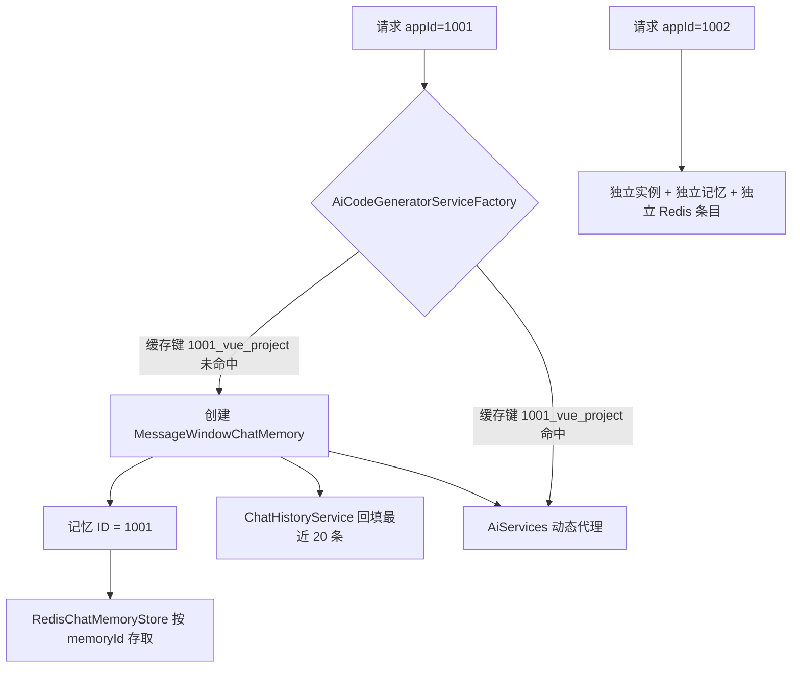

**企业落地**：多租户场景的记忆 key 至少拆成 `tenantId:userId:sessionId`，并配 TTL 与存储配额；同一会话的并发写入要么加锁，要么做"消息序号 + 乐观并发"；合规上还要支持清空记忆、导出记忆、按用户删除。

---

## 12040. 为什么要从数据库加载对话历史到记忆中？完整流程是怎样的？

`中等` `后端` `编程导航`

**推荐答案**

因为 Redis 记忆有 TTL、Caffeine 实例也会被淘汰，实例重建时记忆是空的；所以在创建 AI 服务时从 MySQL 回填最近 20 条历史，保证用户隔一段时间回来继续对话时，AI 仍然"记得住"。

1. **触发时机**：请求进入 `getAiCodeGeneratorService(appId, type)`，Caffeine 未命中才会走 `createAiCodeGeneratorService`，回填只发生在这个冷启动路径上。
2. **建记忆**：先构建 `MessageWindowChatMemory(id=appId, chatMemoryStore=redisChatMemoryStore, maxMessages=20)`。
3. **查历史**：`ChatHistoryServiceImpl.loadChatHistoryToMemory` 按 `appId` 查询，`createTime` 倒序取 20 条，再反转成时间正序，保证喂给模型的顺序符合对话习惯。
4. **写记忆**：先 `clear()` 清空旧内容，再按 `messageType` 把 user 消息转成 `UserMessage`、ai 消息转成 `AiMessage`，逐条写入记忆窗口。
5. **窗口对齐**：`maxMessages(20)` 与回填条数 20 必须一致；回填 50 条会被窗口挤掉 30 条，白白多查一次库。
6. **两个坑**：一是错误提示若也落库，回填后会污染 AI 上下文，需要按消息类型过滤；二是两个请求并发创建实例可能重复回填，`Caffeine.get(key, mappingFunction)` 的原子性可以缓解。

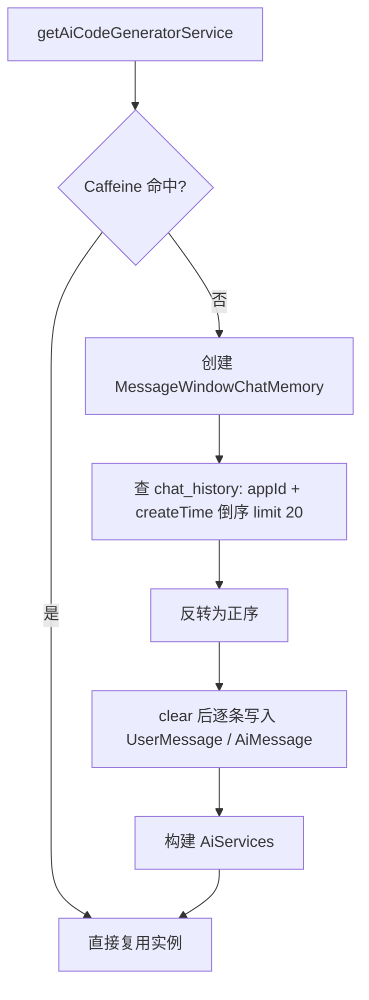

**企业落地**：回填是冷启动成本，应用多、实例频繁重建时会反复查库，企业会做"记忆快照缓存"或延长 Redis TTL；超长会话不能全量回填，标准做法是"早期消息摘要 + 最近 N 条原文"，既保留上下文又控制 token。

---

## 12041. 如何配置 Caffeine 的缓存策略？

`中等` `后端` `编程导航`

**推荐答案**

项目缓存的是"带记忆的 AI 服务实例"，配置为最大 1000 个、写入后 30 分钟过期、访问后 10 分钟过期、移除时打日志，缓存键是 `appId_type`。

1. **`maximumSize(1000)`**：实例内部持有记忆窗口、模型客户端、工具集，数量必须封顶，否则应用数一多就 OOM。
2. **`expireAfterWrite(Duration.ofMinutes(30))`**：写入后最长存活 30 分钟，防止模型配置、记忆结构变更后仍长期使用旧实例。
3. **`expireAfterAccess(Duration.ofMinutes(10))`**：10 分钟没人访问就回收，专门清理"创建后只用过一次"的应用，节省内存。
4. **两者同时存在时"先到期者生效"**：不是叠加计时，而是任一条件满足就淘汰，所以实际寿命是"30 分钟内且最近 10 分钟被访问过"。
5. **`removalListener`**：记录 key 与淘汰原因（SIZE / EXPIRED / EXPLICIT），排查"为什么实例又重建了"时非常有用。
6. **为什么值得缓存**：创建一次实例要建记忆、连 Redis、回填 20 条历史、组装 AiServices 动态代理，成本远高于一次 Map 查找；同一应用连续对话会高频命中。

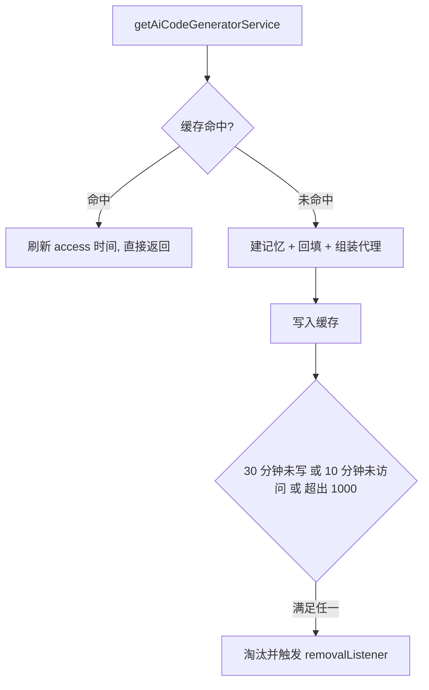

**企业落地**：单机 Caffeine 在多实例部署时会各建一份，企业常用"Caffeine 本地 + Redis 分布式"两级缓存，或干脆把 AI 服务做成无状态、按请求组装；缓存必须配命中率、淘汰原因监控，否则很容易出现"以为在缓存、其实一直未命中"。

---

## 12042. 后端如何实现可视化修改功能？

`中等` `后端` `编程导航`

**推荐答案**

后端**没有专门的"可视化修改"接口**。前端把「页面路径 + 标签 + 选择器 + 当前内容」拼进普通对话消息，后端按同一条 SSE 生成链路处理，由 AI 通过文件工具去改对应文件。

1. **前端协议**：可视化编辑器捕获点击后生成 `ElementInfo`，用户输入修改要求时，把这段结构化描述追加到消息文本里，再调用原来的 `/app/chat/gen/code`。
2. **后端入口不变**：`AppController.chatToGenCode` 收到的仍然只是一个 `message` 字符串，没有 `elementInfo` 参数，所以 Controller、Service、限流、监控全部零改造。
3. **执行差异**：Vue 工程模式下，模型用 `read_file / modify_file / write_file` 定位并修改具体文件；HTML/多文件模式下，模型倾向重新生成整份文件再覆盖。
4. **复用能力**：对话记忆、流式输出、工具调用展示、限流、可观测性都沿用原链路，这是"不新增接口"最大的收益。
5. **局限要讲清楚**：选择器只是"文本提示"，模型可能找错元素；没有 diff/patch，往往整文件重写，容易误伤其他样式；修改失败也没有版本回滚。

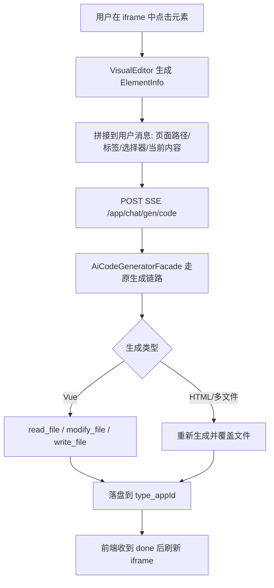

**企业落地**：更工程化的做法是后端提供结构化编辑指令（appId + file + selector + patch），AI 只负责生成 patch，服务端校验后应用；或者前端传 AST 节点路径，后端用 codemod 精确修改；高风险修改要配预览、版本快照与回滚。

---

## 12043. 为 AI 设计文件操作工具时，如何保证安全性？

`中等` `后端` `编程导航`

**推荐答案**

核心是「目录隔离 + 路径规范化 + 越界校验 + 错误不抛异常」，再叠加只读/删除保护、不提供 shell 工具和审计日志；企业级还要上沙箱与资源限额。

1. **目录隔离**：所有文件工具只操作 `tmp/code_output/vue_project_{appId}`，按 appId 分目录，天然把不同应用隔开。
2. **相对路径约定**：工具描述里明确"只接受相对路径"，模型不会（也不应该）拿到服务器绝对路径。
3. **路径穿越校验**：`projectPath.resolve(relative).normalize()` 之后用 `startsWith(projectPath)` 判断，`../` 跳出工作目录的请求直接拒绝。
4. **错误不抛异常**：越界或写入失败时返回一段错误字符串，让模型看到后自行纠正，而不是抛异常炸掉整条生成链路。
5. **工具面收敛**：工具集只有文件读写改删、目录读取、退出，没有命令执行工具，避免模型执行任意 shell。
6. **仍存在的风险（主动说）**：没有文件大小上限，可能写超大文件撑爆磁盘；没有扩展名白名单，可能写 `.sh`、`.env`；删除工具若不做关键文件保护，可能删掉 `package.json`、`vite.config.js`。

```mermaid
flowchart TD
    A[模型调用 write_file] --> B[拼接 projectPath.resolve(relative)]
    B --> C[normalize 消解 ../]
    C --> D{startsWith projectPath?}
    D -->|否| E[返回 非法路径 字符串, 让模型自愈]
    D -->|是| F[createDirectories + writeString]
    F -->|成功| G[返回 写入成功]
    F -->|异常| H[返回 写入失败原因, 不抛出]
```

**企业落地**：沙箱用独立容器/进程，只读根文件系统 + 可写工作目录 + CPU/内存/磁盘限额 + 网络隔离；策略上加扩展名白名单、文件大小上限、敏感文件名黑名单、内容扫描（密钥/恶意脚本）；高风险操作（删目录、部署、执行命令）加人工确认与审计。

---

## 12044. 项目后期为什么要引入 LangGraph4j 构建 AI 工作流？和之前相比解决了什么问题？

`困难` `后端` `编程导航`

**推荐答案**

之前的链路是「一条直线 + 一次模型调用」，缺分支、并发、重试和状态管理；LangGraph4j 把流程显式建模成「节点 + 边 + 条件边 + 并发分支 + 共享状态」，解决了多步骤编排、图片并发收集、质检回退和可观测的问题。

1. **旧链路的局限**：`AiCodeGeneratorFacade` 直调模型，只能"一次生成 + 一次解析落盘"；想做"先规划图片 → 并发收集 → 增强提示词 → 生成 → 质检 → 构建"就得在 Service 里写一大段过程代码，分支和重试散落各处。
2. **节点化**：每个步骤是一个 `Node`（`ImagePlanNode`、`RouterNode`、`CodeGeneratorNode`…），职责单一，可单独测试、单独替换。
3. **边与条件边**：普通边表达串行顺序；条件边让 `code_quality_check` 根据结果走 `build / skip_build / fail`，把"如果……就……"从 if/else 变成图结构。
4. **并发分支**：`image_plan` 同时连到 4 个收集节点，再由 `ImageAggregatorNode` 汇聚，框架负责并行调度与同步点。
5. **共享状态**：`WorkflowContext` 随图流转，集中存放提示词、图片、生成类型、产物目录、质检结果，节点只读写自己的字段。
6. **可观测**：图可以用 Mermaid 打印出来，调试和讲解时"流程长什么样"一目了然，而不是靠读几百行过程代码脑补。

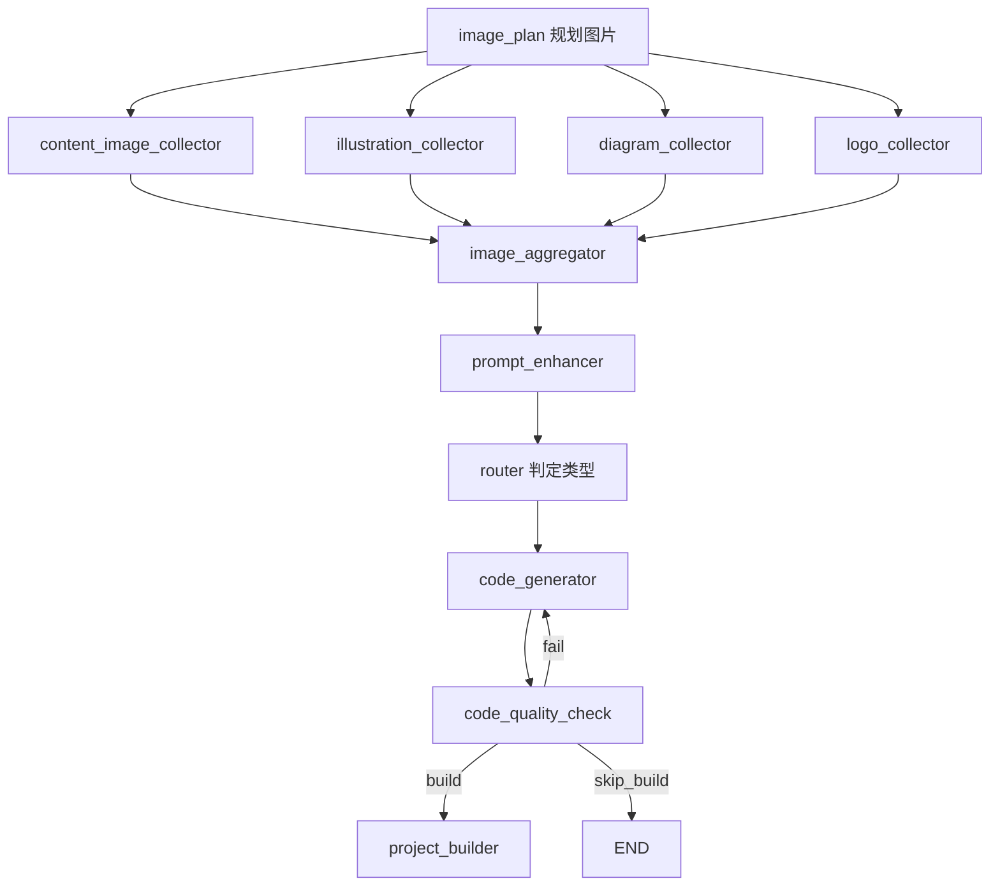

**企业落地**：图编排适合"多步骤、有分支、有重试"的 Agent 流程，简单的一次调用用图反而是过度设计；代价是学习成本、调试复杂、并发写状态有覆盖风险（分支只能写互不重叠字段）。企业还会补持久化 checkpoint、human-in-the-loop、超时与重试上限、图版本管理。

---

## 12045. 描述 AI 代码生成工作流的核心节点以及数据流转？

`中等` `后端` `编程导航`

**推荐答案**

主链路是：`image_plan` 规划 → 4 个收集节点并发取图 → `image_aggregator` 聚合 → `prompt_enhancer` 增强提示词 → `router` 选类型 → `code_generator` 生成 → `code_quality_check` 质检 → 按结果构建/结束/重试。

1. **规划阶段**：`image_plan` 用 AI 把需求拆成内容图、插画、架构图、Logo 四类任务，写入 `imageCollectionPlan`。
2. **并发收集**：`content_image_collector / illustration_collector / diagram_collector / logo_collector` 分别调用 `ImageSearchTool`、`UndrawIllustrationTool`、`MermaidDiagramTool`、`LogoGeneratorTool`，各自写入 `contentImages / illustrations / diagrams / logos`。
3. **聚合与增强**：`image_aggregator` 合并成 `imageList / imageListStr`，`prompt_enhancer` 把可用图片资源拼进提示词，得到 `enhancedPrompt`。
4. **类型路由**：`router` 根据需求复杂度判定 HTML、MULTI_FILE 还是 VUE_PROJECT，写入 `generationType`。
5. **生成与质检**：`code_generator` 调 AI 生成并落盘到 `generatedCodeDir`，`code_quality_check` 产出 `qualityResult`。
6. **条件分支**：Vue 且质检通过 → `project_builder`；HTML/多文件 → `END`；质检失败 → 回到 `code_generator` 重试。

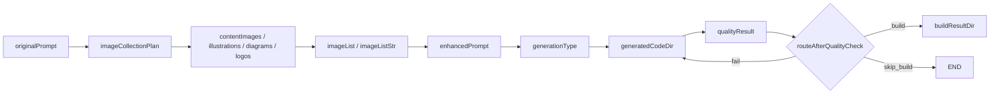

**企业落地**：状态集中管理便于调试，但并发分支只能写互不重叠的字段；质检回退必须配最大重试次数，否则可能无限循环（本项目未显式设置 `recursionLimit`，是可改进点）；企业会把每个节点的输入输出落日志/追踪，形成可回放的执行记录。

---

## 12046. 图片收集节点中如何实现对多个图片工具的并发调用？

`中等` `后端` `编程导航`

**推荐答案**

两层并发：图层面 `image_plan` 并行分发到 4 个收集节点，由配置的线程池执行；节点内部再对"多个具体任务"用 `CompletableFuture.supplyAsync` 并发执行，`allOf().join()` 汇总。

1. **第一层是图并发**：`RunnableConfig.builder().addParallelNodeExecutor("image_plan", pool)` 指定并行执行器，`image_plan` 同时连到 4 个 collector，框架按该线程池并行调度。
2. **线程池参数**：core 10、max 20、队列 100，并配了带业务名的 `ThreadFactory`，避免所有并行任务挤在 `ForkJoinPool.commonPool`。
3. **第二层是节点内并发**：`ImageCollectorNode` 把每一类图片任务包装成 `CompletableFuture.supplyAsync(...)`，四类任务全部提交后 `allOf(...).join()` 等齐再继续。
4. **结果汇总**：每个分类返回 `List<ImageResource>`，节点内合并去重，最后由 `ImageAggregatorNode` 汇总成统一的 `imageList`。
5. **状态写入要隔离**：四个分支只写自己的字段（`contentImages`、`illustrations`…），聚合节点再读，避免并发写同一字段互相覆盖。
6. **可改进点**：`supplyAsync` 没传自定义线程池，默认用公共池；任务数量没有上限，需求复杂时可能一次发起几十个外部请求，需要并发度限制、超时和熔断。

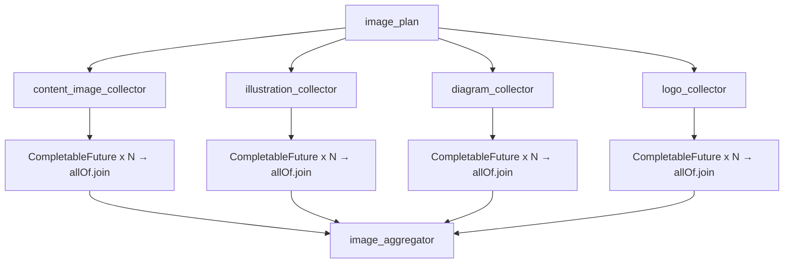

**企业落地**：并发必须配"隔离线程池 + 超时 + 限流 + 熔断"，避免把下游图片服务打爆；结果要去做可用性校验（URL 是否可访问）与缓存（同 query 复用）；失败要降级，某类图失败不应阻断主流程，可用占位图或跳过。

---

## 12047. 如何实现应用封面图自动生成？Selenium 有什么作用？为什么选择它？

`中等` `后端` `编程导航`

**推荐答案**

应用部署成功后，用 Selenium 驱动无头 Chrome 打开部署 URL，等页面渲染完截图，压缩后上传 COS，最后回写 `app.cover`；选它是因为需要"真实浏览器执行 JS、加载 CSS、完成布局之后"的视觉效果。

1. **前置动作**：`deployApp` 生成 `deployKey`，把产物拷贝到 `tmp/code_deploy/{deployKey}`，拼出公开访问 URL，然后触发截图。
2. **Selenium 的作用**：不是"发 HTTP 拿 HTML"，而是启动真实浏览器，执行 JS、加载样式、完成布局后再截图，Vue 这类 SPA 也能截到最终画面。
3. **驱动准备**：`WebDriverManager.chromedriver().setup()` 自动匹配浏览器版本的驱动，省去手动下载和版本不一致的问题。
4. **无头参数**：`--headless`、`--disable-gpu`、`--no-sandbox`、`--disable-dev-shm-usage`；后两个是容器/Root 环境的必需项。
5. **为什么不用其他方案**：Jsoup 不执行 JS，动态页面截出来是空白；wkhtmltopdf 内核老、现代 CSS 支持差；html2canvas 需要用户打开页面，无法服务端自动生成；Playwright 更现代但要引入 Node 运行时。
6. **真实问题**：浏览器启动慢、资源占用高、单机并发差；固定 `sleep` 等渲染不可靠，应用 `WebDriverWait` 等关键元素可见；无论成败都要在 `finally` 里 `quit()`。

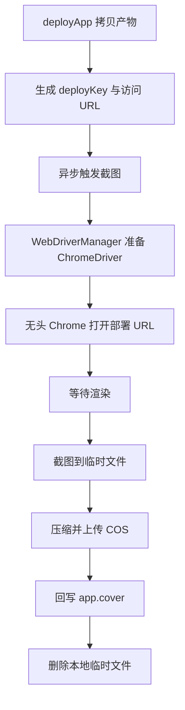

**企业落地**：Selenium 偏重，企业更常用 Playwright、云厂商"网页截图 API"或独立截图服务 + 队列；截图要设总超时、固定视口、显式等待，失败要重试与补偿，不要让封面永久为空。

---

## 12048. AI 零代码应用生成项目中，为什么截图服务要设计为异步执行？如何实现异步？

`中等` `后端` `编程导航`

**推荐答案**

截图要启动浏览器、等待渲染，耗时数秒且可能失败，不能拖慢部署响应；项目在部署完成后用 Java 21 虚拟线程 `Thread.startVirtualThread` 异步执行截图，失败只记日志、不影响部署结果。

1. **用户体验**：部署的核心诉求是"尽快拿到可访问 URL"，封面只是增强信息。同步截图会让接口 RT 凭空增加 2~10 秒，用户盯着转圈。
2. **吞吐量**：Tomcat 的平台线程是有限资源（默认 200 左右），如果请求线程都阻塞在"启动浏览器 + 等渲染"上，线程池很快被占满，其他接口排队，整体吞吐骤降；异步把这段等待移出请求线程。
3. **失败隔离**：截图可能因超时、页面报错、COS 异常失败，同步执行会让部署接口报错甚至回滚；异步 catch 住只记日志，部署照常成功。
4. **实现方式**：`Thread.startVirtualThread(() -> { try { 生成并上传封面 → app.setCover → updateById } catch (Exception e) { log.error(...) } })`。
5. **为什么用虚拟线程**：截图是阻塞式 IO（等浏览器、等网络），虚拟线程在阻塞时自动让出载体线程，开销远小于平台线程，也不需要额外维护线程池。
6. **边界与瑕疵**：虚拟线程里没有请求线程的事务上下文，更新数据库要自己保证；没有重试与补偿，失败后封面永久为空；应用关闭时不会等待任务结束。

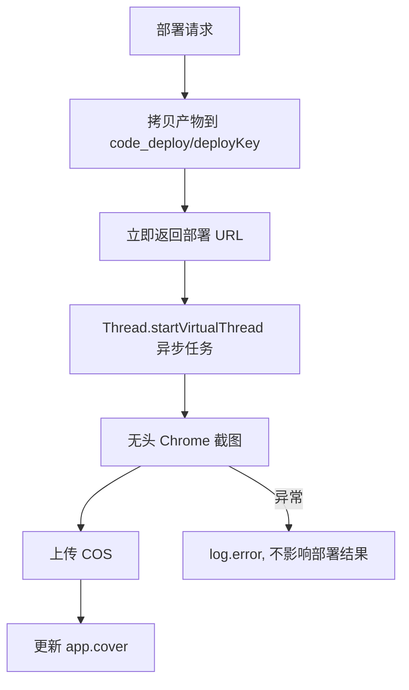

**企业落地**：更稳的做法是把截图任务投进消息队列（MQ / Redis Stream），由独立 worker 消费，支持重试、死信、限流；截图服务独立部署，避免浏览器进程影响主应用；状态机 `PENDING → SUCCESS / FAILED`，前端轮询或推送封面状态。

---

## 12049. 如何实现项目代码的打包下载？如何过滤不必要文件和目录？

`简单` `后端` `编程导航`

**推荐答案**

用 Hutool 的 `ZipUtil.zip` 把项目目录流式压缩到 HTTP 响应输出流，压缩时用 `FileFilter` 逐段校验相对路径，过滤 `node_modules/.git/dist/build/.env` 等目录和 `.log/.tmp/.cache` 等扩展名。

1. **入口校验**：下载接口先校验 appId 属主，再确认项目目录存在，避免越权下载别人的代码。
2. **响应头**：`Content-Type: application/zip` + `Content-Disposition: attachment; filename="xxx.zip"`，让浏览器直接下载。
3. **过滤名单**：目录名 `node_modules、.git、dist、build、target、.mvn、.idea、.vscode、.DS_Store、.env`；扩展名 `.log、.tmp、.cache`。
4. **逐段校验**：用 `projectRoot.relativize(fullPath)` 得到相对路径后遍历每一段，任一段命中忽略名单就返回 false，所以 `node_modules/xxx` 这种深层路径也能过滤。
5. **流式压缩**：`ZipUtil.zip(response.getOutputStream(), UTF_8, false, filter, projectDir)`，边压边写，不落临时 zip 文件，内存占用低、首字节快。
6. **安全动机**：过滤 `.env` 是防止密钥被打包泄露；过滤 `dist/build` 是"源码包不带构建产物"，减小体积。

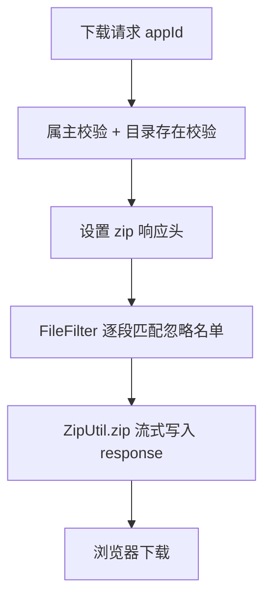

**企业落地**：大项目用"异步打包 + 对象存储 + 临时签名下载链接"，避免长时间占用连接；下载要鉴权、防盗链、设有效期；敏感文件过滤最好白名单化（只允许源码与配置模板），而不是靠黑名单。

---

## 12050. 为什么采用「Spring Boot 接口预览 + Nginx 部署」的混合方案？各自解决什么问题？

`中等` `后端` `编程导航`

**推荐答案**

预览走 Spring Boot 静态资源接口，解决"生成后立刻能看、同源、带登录态、零额外运维"；部署走 Nginx 静态站点，解决"公网访问、高并发、与应用解耦、独立生命周期"。两者场景不同，不能互相替代。

1. **预览场景**：地址是 `/api/static/{codeType}_{appId}/**`，由 `StaticResourceController` 从 `tmp/code_output` 读文件；生成完立即生效，不需要拷贝、不需要额外服务。
2. **同源是硬需求**：可视化编辑要往 iframe 注入脚本、读 DOM、`postMessage`，跨域会被浏览器直接拦截，所以预览必须和主站同源。
3. **部署场景**：`deployApp` 生成 `deployKey`，把产物拷到 `tmp/code_deploy/{deployKey}`，通过 Nginx 以 `/{deployKey}/` 公开访问，属于"快照"，后续继续改预览目录也不会影响已部署版本。
4. **性能与解耦**：静态文件交给 Nginx，高并发、零 GC、可独立扩容；应用服务器只处理 API，不被静态资源 IO 拖累。
5. **生命周期**：预览目录跟随应用存在，会随继续对话而变化；部署目录是某一时刻的产物，可长期保留、可回滚、可单独迁移到对象存储。
6. **取舍**：预览用应用服务器只适合小流量；部署如果不做鉴权就是"链接即公开"，企业要加访问控制、过期策略或独立域名。

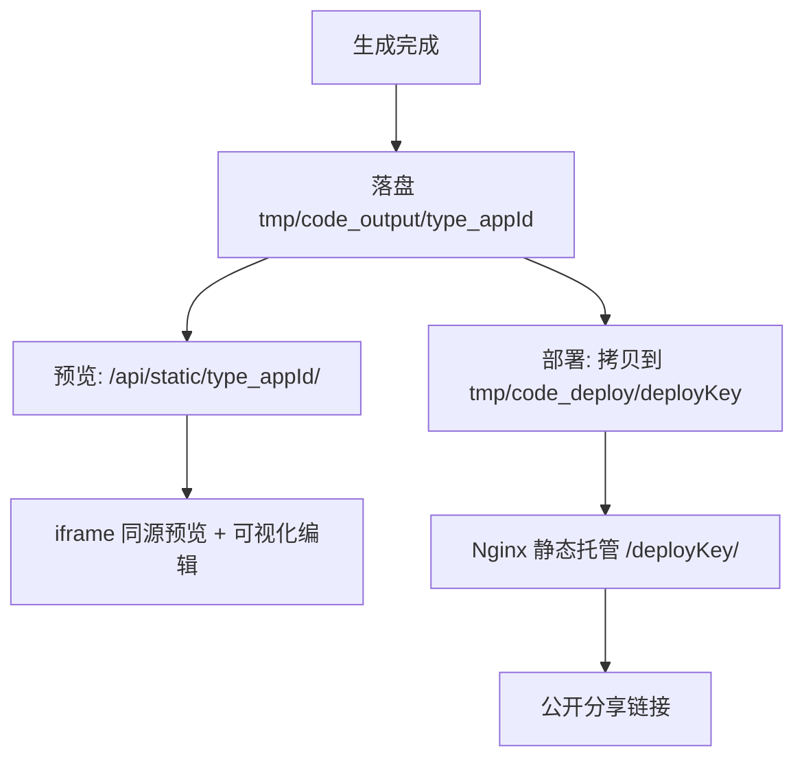

**企业落地**：预览也会逐步迁到"预览域名 + Nginx/对象存储 + 短期签名 URL"；部署产物放对象存储 + CDN，Nginx 只做入口与反向代理；预览态与部署态目录分离是硬约束，避免"改预览把线上改坏"。

---

## 12051. Nginx 承担了哪些职责？具体如何配置？

`中等` `后端` `编程导航`

**推荐答案**

在本项目里 Nginx 主要承担「部署产物静态托管 + `/api` 反向代理 + SSE 长连接优化 + 压缩/缓存/HTTPS/SPA 路由回退」。仓库中没有 Nginx 配置文件，这属于部署环境配置。

1. **静态托管**：`root /path/to/tmp/code_deploy;`，按 `/{deployKey}/` 直接访问部署产物。
2. **反向代理**：`location /api/ { proxy_pass http://127.0.0.1:8123/api/; }`，把 API 与 SSE 转发给 Spring Boot。
3. **SSE 关键配置**：`proxy_buffering off; proxy_cache off; proxy_read_timeout 3600s;`，否则 token 会被 Nginx 缓冲，前端表现为"卡很久，然后一次性输出"。
4. **压缩**：`gzip on; gzip_types text/css application/javascript application/json;`，静态资源体积明显下降。
5. **缓存与 SPA 回退**：带 hash 的静态资源长缓存，HTML 短缓存或不缓存；Vue history 模式需要 `try_files $uri $uri/ /index.html;`。
6. **安全与限制**：HTTPS 证书与 301 跳转、`client_max_body_size`、连接数/请求数限流、访问日志。

```nginx
server {
    listen 80;
    server_name code.example.com;
    root /opt/yu-ai-code/tmp/code_deploy;

    location / { try_files $uri $uri/ =404; }

    location /api/ {
        proxy_pass http://127.0.0.1:8123/api/;
        proxy_http_version 1.1;
        proxy_set_header Host $host;
        proxy_buffering off;          # SSE 必须关闭缓冲
        proxy_cache off;
        proxy_read_timeout 3600s;
    }
}
```

**企业落地**：单机 Nginx 足够；K8s 场景用 Ingress 或网关（如 Higress）替代；部署产物建议放对象存储 + CDN，Nginx 只做入口；SSE 必须关缓冲并配好超时，否则流式体验直接失效。

---

## 12052. AI 调用性能存在瓶颈的根本原因是什么？

`困难` `后端` `编程导航`

**推荐答案**

根本原因是 LangChain4j 的 `ChatModel` 实例在 Spring 容器中被配置成了单例，而且流式模型虽然返回的是看似异步的 `Flux` 对象，但其底层网络客户端在处理数据流时是同步阻塞的。这导致多个用户请求同时到达时，由于只有一个 `ChatModel` 实例，它们必须排队等待：第一个请求会锁定这个单例实例，直到它与 AI 大模型的整个通信过程完全结束，在此期间其他请求全部被阻塞。最终，系统处理 AI 请求的行为从并发退化成了串行，后续用户必须等前面所有请求完成才能得到响应。

1. **单例共享**：Spring 容器里只有一个 `ChatModel` 实例，所有用户的流式请求共用同一个对象，没有按请求或按租户隔离。
2. **"看似异步"的 Flux**：`StreamingChatModel.chat()` 返回 `Flux`，调用方以为订阅后就异步了；但底层 HTTP 客户端读取响应流是阻塞式的，订阅线程会被一直占用。
3. **串行化过程**：请求 A 先拿到实例并开始阻塞读取，请求 B 只能等待；A 的整个生成过程（可能几十秒）结束后 B 才真正开始，RT 叠加、吞吐骤降。
4. **调用链可以背下来**：`用户调用流式聊天接口 → StreamingChatModel.chat() → OpenAIStreamingChatModel.doChat() → OpenAIClient.chatCompletion() → StreamingRequestExecutor.execute() → SpringRestClient.execute() → AsyncTaskExecutor.execute() → RestClient.exchange() → InputStream response.getBody()`。
5. **影响面**：首字延迟被前面请求拖长、并发用户越多越慢、容易触发超时与重试，重试又进一步加剧排队。
6. **解决方向**：不要共享单例，按 appId/租户复制模型原型或建实例池；底层改用真正的异步客户端/连接池；请求线程与 IO 线程隔离；入口做并发配额与排队上限；必要时把 AI 生成拆成独立服务单独扩容。

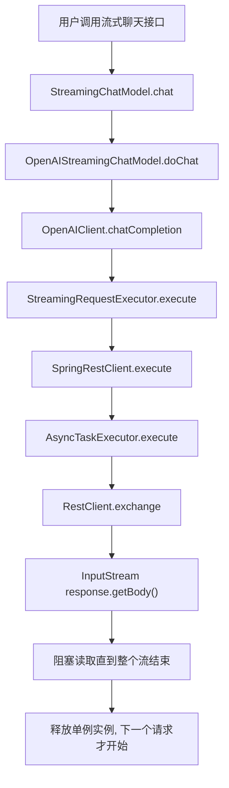

**企业落地**：不同 LangChain4j 版本的底层实现细节可能不同（有的走 OkHttp 异步回调），但面试要抓住根因——"共享单例 + 阻塞式 IO + 缺少并发隔离"。排查方式是压测时 `jstack` 看线程是否大量堆在 socketRead，或看连接池等待数；治理手段是模型网关、连接池、租户级并发配额、超时熔断和独立扩容。

---

## 12053. Redis 主要用在哪些场景？

`简单` `后端` `编程导航`

**推荐答案**

项目里 Redis 承担四类职责：Spring Session 共享登录态、AI 对话记忆、Redisson 分布式限流、业务缓存（`RedisCacheManager`），共同点是"跨实例共享 + 需要 TTL + 需要原子操作"。

1. **Spring Session**：登录态存 Redis，Session 有效期 30 天，前后端分离、后端多实例部署时都能共享同一个登录态。
2. **对话记忆**：`RedisChatMemoryStore` 按 memoryId 存取消息，TTL 3600 秒，应用实例被淘汰后记忆仍能在有效期内恢复。
3. **分布式限流**：Redisson `RRateLimiter` 存令牌桶状态，多实例共享同一份计数，避免"每台机器各限各的"。
4. **业务缓存**：`RedisCacheManager` 缓存精选应用列表等读多写少的数据，降低数据库压力。
5. **为什么选 Redis**：内存级性能、天然支持 TTL、原子命令与 Lua、数据结构丰富，且项目已经为 Session 引入了 Redis，复用成本最低。
6. **注意事项**：key 要带业务前缀与版本；TTL 加随机抖动避免同一时刻集体失效；避免大 key（如整个会话塞一个 value）；热 key 要做本地缓存或拆分。

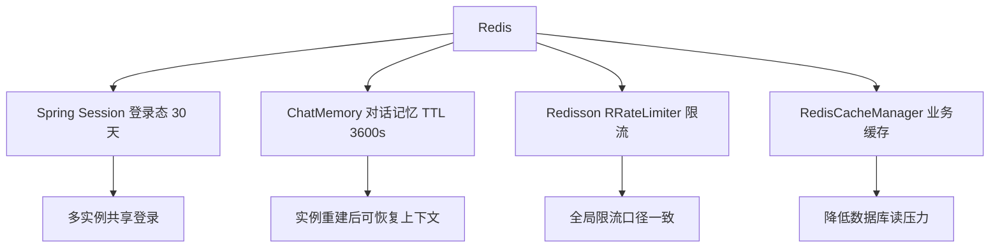

**企业落地**：生产用集群/哨兵并区分缓存与持久化用途；key 规范、TTL 规范、容量与慢查询监控要统一；缓存与数据库的一致性策略（先更新库再删缓存、延迟双删）要提前约定，不要等出问题再补。

---

## 12054. 什么是 SSE？为什么 AI 生成代码时选择 SSE？

`中等` `后端` `编程导航`

**推荐答案**

SSE（Server-Sent Events）是基于 HTTP 的单向服务端推送协议，响应类型是 `text/event-stream`，服务端持续写 `data:` 行，浏览器用 `EventSource` 自动接收并支持断线重连。AI 生成代码是"服务端持续产出 token、客户端只接收"的单向流，SSE 正好匹配，且比 WebSocket 更简单。

1. **协议要点**：响应头 `Content-Type: text/event-stream`，事件由 `event:`、`data:`、`id:`、`retry:` 组成，以空行分隔；本质是"一个不结束的 HTTP 响应"。
2. **为什么不用轮询**：轮询要么延迟高，要么请求量巨大；生成过程持续几十秒，轮询会制造大量无效请求。
3. **为什么不用 WebSocket**：WebSocket 是全双工，需要额外握手、心跳、连接管理，网关与鉴权也更复杂；本场景只需要服务端 → 客户端单向推送，SSE 足够。
4. **项目实现**：Controller 返回 `Flux<ServerSentEvent<String>>`，`produces = MediaType.TEXT_EVENT_STREAM_VALUE`；Facade 把 LangChain4j 的 `TokenStream` 桥接成 `Flux`，逐段推送。
5. **协议细节**：每个 chunk 用 `{"d": "..."}` JSON 包装，避免代码里的换行破坏 SSE 的"行"语义；结束时发 `done`，业务异常发 `business-error`。
6. **局限**：`EventSource` 只支持 GET、不能自定义 Header，消息只能放 URL；HTTP/1.1 同域连接数有限（约 6 个）；代理不关缓冲会导致"假流式"。

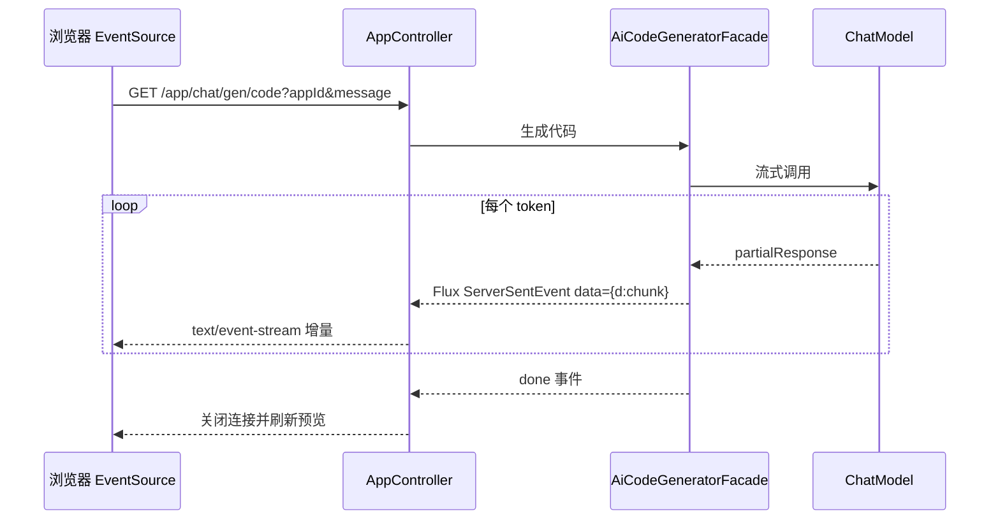

**企业落地**：生产要配心跳事件、`Last-Event-ID` 续传、网关/ Nginx 关闭缓冲、连接数与超时限制；消息很长时改用 `POST + fetch ReadableStream` 绕过 URL 长度限制；多标签页场景注意浏览器连接数上限。

---

## 12055. 如何优化调用 AI 接口的 SSE 流式输出效果？

`中等` `后端` `编程导航`

**推荐答案**

优化的核心是"让 token 尽快、稳定、可读地到达前端"：用 `Flux.create` 把 `TokenStream` 的回调桥接成响应式流，按事件类型分别推送，前端增量渲染并批量刷新，同时在网关层关闭缓冲、在完成事件后再刷新预览。

1. **桥接层**：`Flux.create(sink -> tokenStream.onPartialResponse(...).onPartialToolExecutionRequest(...).onToolExecuted(...).onCompleteResponse(...).onError(...).start())`，把回调式 API 转成背压友好的 `Flux`。
2. **协议包装**：每个片段序列化成 `{"d": "..."}`，换行被转义，SSE 的 `data:` 行不会被破坏；前端只解析 `d` 字段。
3. **事件分层**：`ai_response` 追加正文，`tool_request` 输出去重后的"正在调用"，`tool_executed` 输出结果并落库，避免工具日志和正文混在一起。
4. **完成与异常**：`onCompleteResponse` 里先落盘（Vue 还要构建）再 `sink.complete()`；`onError` 调 `sink.error()`；业务异常用 `business-error` 事件单独表达。
5. **取消与背压**：发送前检查 `sink.isCancelled()`，用户关闭页面后停止推送；高频小片段可按时间窗口聚合后再发，减少 SSE 事件数量。
6. **前端配合**：增量累加内容并自动滚动；长文本用 `requestAnimationFrame` 批量更新，避免每个 token 都触发一次 Markdown 重渲染；`done` 后延迟约 1 秒再刷新 iframe，等落盘/构建完成。

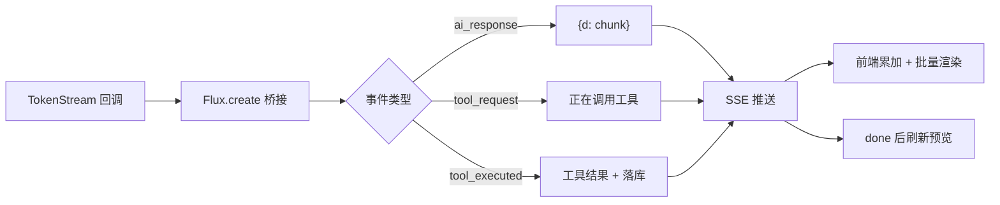

**企业落地**：把首字延迟（TTFT）、每段间隔、总时长做成指标；SSE 链路禁用压缩与缓冲；对超长输出做分段与截断策略；网络差时用"聚合发送 + 心跳"换取稳定性，而不是一味追求逐字。

---

## 12056. 如何实现工具调用信息的流式输出？

`中等` `后端` `编程导航`

**推荐答案**

靠 LangChain4j 的工具回调：`onPartialToolExecutionRequest` 拿到"模型正在请求调用工具"的片段，`onToolExecuted` 拿到执行结果；后端在 `JsonMessageStreamHandler` 里按消息类型合并、去重，再通过 SSE 推给前端。

1. **回调来源**：`TokenStream` 提供 `onPartialResponse`、`onPartialToolExecutionRequest`、`onToolExecuted`、`onCompleteResponse` 等钩子，工具调用不再是黑盒。
2. **请求片段处理**：工具参数是流式生成的，可能分多次到达，必须按工具调用 ID 聚合，不能每来一段就推一条"正在调用"。
3. **结果处理**：`onToolExecuted` 拿到工具名、参数、执行结果，输出给前端展示，同时把工具结果落库，保证刷新后历史完整。
4. **类型合并**：`JsonMessageStreamHandler` 按 `ai_response / tool_request / tool_executed` 分别处理；连续同类型消息合并，避免前端出现大量碎片气泡。
5. **防死循环**：配置 `maxSequentialToolsInvocations(20)` 限制连续工具调用次数；`hallucinatedToolNameStrategy` 处理模型编造不存在工具名的情况。
6. **前端呈现**：工具调用展示为"正在调用 xxx / 执行结果"，与正文分开展示；参数里的敏感信息（路径、密钥）要做脱敏。

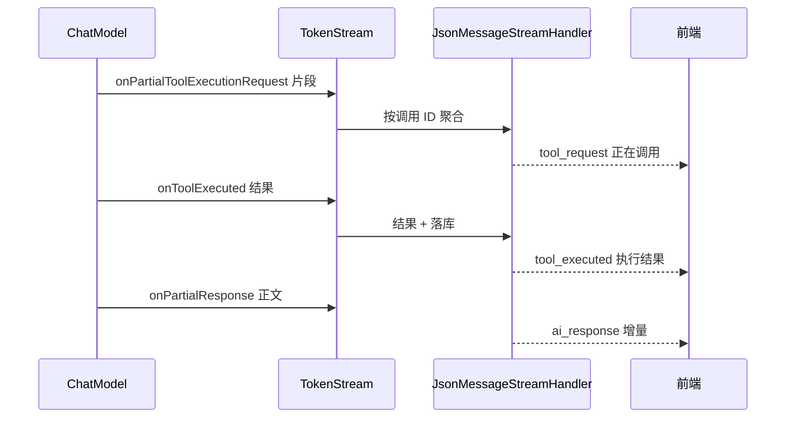

**企业落地**：工具调用要留完整审计（入参、出参、耗时、失败原因）；高风险工具加人工确认；前端用时间线展示"思考 → 调工具 → 结果 → 回答"，比单纯打字机更可信；工具结果要做大小截断，避免把整份文件内容推给前端。

---

## 12057. 如何为 AI 对话接口实现限流？解释一下原理。

`中等` `后端` `编程导航`

**推荐答案**

项目用「自定义 `@RateLimit` 注解 + AOP 环绕通知 + Redisson `RRateLimiter`」实现分布式限流：按用户 ID（未登录按 IP）拼 key，令牌桶算法控制速率，拿不到令牌就抛 `TOO_MANY_REQUEST`。

1. **注解**：`@RateLimit(rate = ..., rateInterval = ...)` 标在对话接口上，把限流参数与业务代码解耦。
2. **AOP 切面**：`@Around("@annotation(rateLimit)")` 拦截方法，从登录态取 userId，取不到则退化为 IP，拼成 `rate_limit:user:{id}` 或 `rate_limit:ip:{ip}`。
3. **创建限流器**：`RRateLimiter.trySetRate(RateType.OVERALL, rate, rateInterval, RateIntervalUnit.SECONDS)`，并设置 `expire(1h)`，避免长期不用的 key 堆积。
4. **令牌桶原理**：桶容量为 `rate`，按 `rate / rateInterval` 的速率补充令牌；请求来先 `tryAcquire(1)`，有令牌放行，没有就拒绝。它允许一定突发（最多攒满一桶），长期平均速率受控。
5. **为什么用 Redis**：多实例部署时计数必须共享，否则每台机器各限各的，总量会翻倍；Redisson 用原子脚本保证并发安全。
6. **失败策略**：超过阈值抛业务异常，前端展示"请求过于频繁"；Redis 不可用时要决定"放行（保可用）还是拒绝（保稳定）"，通常核心链路选放行并降级到本地限流。

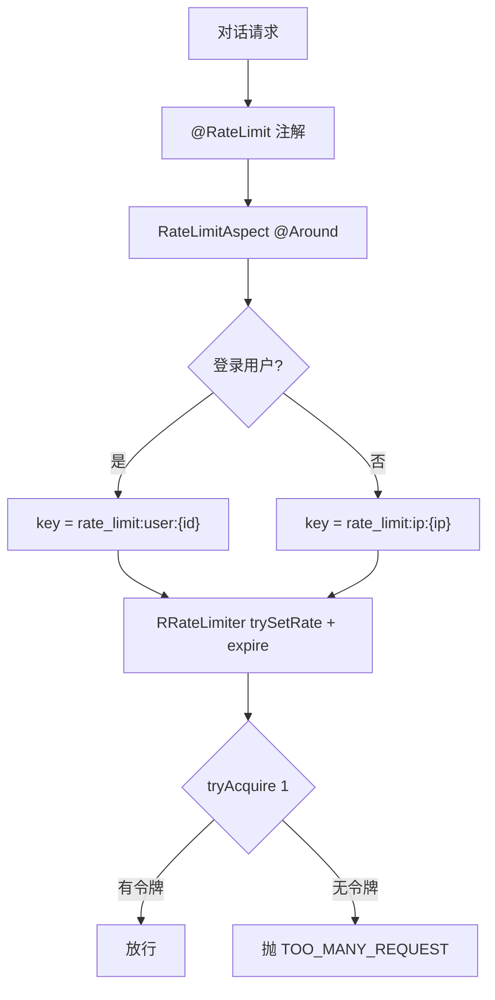

**企业落地**：生产一般做多级限流——网关层按 IP/租户粗粒度、应用层按用户细粒度、模型层按 token 配额；算法按场景选令牌桶（允许突发）、漏桶（平滑输出）、滑动窗口（精确统计）；限流要和监控、告警、排队降级一起设计，不能只丢一个 429。

---

## 12058. 什么是可观测性？为什么需要为 AI 项目构建可观测性体系？

`困难` `后端` `编程导航`

**推荐答案**

可观测性是通过「指标、日志、链路追踪」推断系统内部状态的能力。AI 项目链路长、外部依赖多、成本与质量都不可见，所以项目用 Micrometer + `ChatModelListener` 埋点，把模型、耗时、token、错误暴露给 Prometheus/Grafana；ARMS 属于云上 APM 的可选补充，代码里并未接入。

1. **为什么 AI 项目更需要**：一次生成跨越应用、模型、工具、文件系统、构建、截图多个环节，出问题时"慢在哪、错在哪、贵在哪"必须能定位。
2. **埋点入口**：`AiModelMonitorListener` 实现 `ChatModelListener` 的三个钩子——`onRequest`、`onResponse`、`onError`，覆盖请求开始、成功、失败。
3. **上下文传递**：`MonitorContext`（userId、appId）放在 `MonitorContextHolder` 的 ThreadLocal 里；`onRequest` 把开始时间和上下文塞进 `requestContext.attributes()`，`onResponse` 再取回，解决"回调线程与业务线程不是同一个"的问题。
4. **指标定义**：`AiModelMetricsCollector` 用 Micrometer 的 `Counter` 记请求数与 token 消耗、`Timer` 记响应耗时，tag 包括模型名、状态、appId；用 `ConcurrentHashMap.computeIfAbsent` 缓存已注册指标，避免重复注册抛异常。
5. **暴露与展示**：`management.endpoints.web.exposure.include=prometheus` 暴露 `/api/actuator/prometheus`，Prometheus 抓取，Grafana 做 QPS、错误率、P95、token 成本面板，Alertmanager 配告警。
6. **还缺什么**：目前以指标为主，日志缺少统一 traceId，跨服务没有完整调用链；ARMS 只作为云上 APM 方案提及，代码未接入，面试时要如实说明。

```mermaid
flowchart TD
    A[AI 请求] --> B[AiModelMonitorListener.onRequest]
    B --> C[记录开始时间 + MonitorContext 放入 attributes]
    C --> D[模型调用]
    D --> E{成功?}
    E -->|是| F[onResponse 取回上下文, 计算耗时与 Token]
    E -->|否| G[onError 记录错误类型]
    F --> H[AiModelMetricsCollector Counter / Timer]
    G --> H
    H --> I[/actuator/prometheus]
    I --> J[Prometheus 抓取]
    J --> K[Grafana 面板 + 告警]
```

**企业落地**：三支柱要补齐——日志加 traceId、接入 OpenTelemetry 做跨服务链路、指标控制 tag 基数（userId 这类高基数放日志/追踪）；AI 特有指标建议加 TTFT、tokens/请求、工具失败率、构建成功率、生成采纳率；成本要能按用户/应用/模型聚合，才能做配额与账单。

---
