# AI 零代码应用生成项目 · 面试题标准答案（三）前端 · 可观测 · 微服务 · 综合

> 覆盖原题第 41~62 题，编号 12059~12080。
> 格式说明：每题标题为原题号；标题下方依次为「难度 / 方向 / 来源」标签；正文为**推荐答案**，先给结论，再分点展开，复杂机制配流程图，最后补一段企业落地视角。
> 说明：前端代码位于独立仓库 `yu-ai-code-mother-frontend`；微服务骨架位于 `yu-ai-code-mother-microservice`，目前是「可运行骨架」，网关（Higress）属于规划中的基础设施。

---

## 12059. 什么是 ARMS？如何利用 ARMS 实现系统监控？它主要监控了哪些指标？

`中等` `架构` `编程导航`

**推荐答案**

ARMS（Application Real-Time Monitoring Service）是阿里云的应用实时监控/APM 服务，通过 Java Agent 无侵入采集 JVM、接口、慢 SQL、调用链和异常；它主要看「应用健康、接口性能、依赖拓扑、错误与慢调用」。

1. **应用监控**：JVM 堆/GC/线程数、CPU、接口 RT/QPS/错误率，回答"服务整体健不健康"。
2. **调用链追踪**：一次请求经过哪些服务、数据库、缓存、HTTP 调用，逐段耗时，定位"慢在哪一环"。
3. **慢 SQL 与数据库**：SQL 执行次数、耗时、慢查询 TopN，能直接看到是哪条 SQL 拖慢接口。
4. **异常分析**：异常堆栈聚合、错误率趋势，避免在海量日志里人肉搜索。
5. **依赖拓扑**：应用之间的调用关系与健康度，微服务场景下尤其重要。
6. **接入方式**：给 JVM 加 `-javaagent:/path/arms-agent.jar`，配置 `appName`、License Key、接入点，应用代码零改动，Agent 自动埋点 Spring MVC、JDBC、Redis、HTTP Client。
7. **告警**：阈值/智能告警对接钉钉、短信，属于"发现问题"而不是"展示问题"。

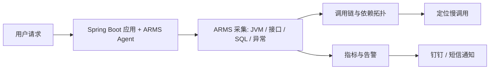

**企业落地**：ARMS 开箱即用、省运维，但按量收费、数据在云厂商；自建 Prometheus + Grafana + Tempo/Jaeger 更自由、成本可控，但要自己维护。常见组合是「ARMS/云 APM 管应用与链路，Prometheus 管业务与技术指标，日志平台（SLS/ELK）管明细」。本项目代码里**没有接入 ARMS**，可观测性实际用的是 Micrometer + Prometheus + Grafana，面试时要如实说明，不要把云上方案说成已实现。

---

## 12060. 为什么除了 ARMS，还需要引入 Prometheus 和 Grafana？这两套方案有什么不同？

`中等` `架构` `编程导航`

**推荐答案**

ARMS 是「商业 APM」，强在调用链与开箱即用；Prometheus + Grafana 是「指标监控栈」，强在自定义业务指标、低成本、可自建。两者定位不同，是互补关系而不是替代关系。

1. **数据模型不同**：ARMS 采集的是调用链、JVM、慢 SQL、异常；Prometheus 存的是时间序列指标（Counter/Gauge/Histogram），适合回答"趋势和速率"。
2. **接入方式不同**：ARMS 靠 Agent 无侵入；Prometheus 靠代码埋点（Micrometer）+ 暴露 endpoint，灵活但需要开发参与。
3. **自定义能力不同**：ARMS 对"按用户/应用/模型统计 token 成本"这类业务指标支持较弱；Prometheus 可以自由设计指标名和 tag，想怎么聚合就怎么聚合。
4. **成本与归属不同**：ARMS 商业收费、数据在云厂商；Prometheus + Grafana 开源自建，只有服务器成本，数据在自己手里。
5. **项目中的实际链路**：`AiModelMetricsCollector` 定义 `ai_model_requests_total`、token 数、响应耗时等指标；`/api/actuator/prometheus` 暴露；`prometheus.yml` 配置抓取；Grafana 建 QPS、错误率、P95、token 消耗面板。
6. **各自盲区**：Prometheus 只有指标，没有调用链和异常堆栈，定位慢 SQL/跨服务瓶颈需要 APM；ARMS 又难以承载高度定制的业务成本指标。

```mermaid
flowchart TD
    A[Spring Boot 应用] --> B[Micrometer 业务指标]
    B --> C[/actuator/prometheus]
    C --> D[Prometheus 抓取存储]
    D --> E[Grafana 面板]
    D --> F[Alertmanager 告警]
    A --> G[ARMS Agent 可选]
    G --> H[调用链 / 慢 SQL / 异常]
```

**企业落地**：小团队用 Prometheus + Grafana + Loki 足够；中大型/云上用「APM（ARMS/SkyWalking）+ Prometheus + 日志平台」组合。要特别注意指标基数：`userId` 这类高基数 tag 会让时间序列爆炸，应该放到日志或追踪里，指标里只保留低基数维度。

---

## 12061. 如何在 AI 项目中实现自定义业务指标的监控？

`中等` `架构` `编程导航`

**推荐答案**

用 Micrometer 的 `Counter` 记"次数/token"，`Timer` 记"耗时"，在 `ChatModelListener` 的请求/响应/错误钩子里埋点，通过 `/actuator/prometheus` 暴露给 Prometheus，再由 Grafana 展示与告警。

1. **上下文**：`MonitorContext` 保存 userId、appId，`MonitorContextHolder` 用 ThreadLocal 承载，业务代码在调用模型前设置。
2. **监听器**：`AiModelMonitorListener` 实现 `ChatModelListener`，`onRequest` 记录开始时间并把上下文放进 `requestContext.attributes()`。
3. **跨线程传递**：模型回调不一定在业务线程上执行，所以不能只靠 ThreadLocal，必须把上下文塞进 `attributes`，`onResponse` 再取回来。
4. **指标收集**：`AiModelMetricsCollector` 用 `Counter` 记请求数与 token（input/output/total）、`Timer` 记响应耗时，tag 包括模型名、状态、appId。
5. **避免重复注册**：用 `ConcurrentHashMap.computeIfAbsent` 缓存已注册的指标对象，Micrometer 重复 `register` 同名同 tag 的指标会抛异常。
6. **暴露与展示**：`management.endpoints.web.exposure.include=prometheus`，Prometheus 抓取后由 Grafana 出面板，Alertmanager 配阈值告警。
7. **可以补充的业务指标**：生成成功率、解析失败率、构建成功率、平均 token/应用、首字延迟 TTFT、限流触发次数、工具调用失败率。

```mermaid
flowchart TD
    A[业务线程设置 MonitorContext] --> B[调用 ChatModel]
    B --> C[AiModelMonitorListener.onRequest]
    C --> D[记录开始时间 + context 放入 attributes]
    D --> E[模型返回 / 抛错]
    E --> F[onResponse / onError 取回上下文]
    F --> G[AiModelMetricsCollector Counter / Timer]
    G --> H[/actuator/prometheus]
    H --> I[Prometheus + Grafana + 告警]
```

**企业落地**：指标命名建议 `<domain>_<subject>_<unit>`，tag 保持低基数；埋点不能影响主流程，异常要吞掉并记日志；成本指标必须能按"用户/应用/模型/天"聚合，才能做配额与账单。指标只能反映"有没有错、快不快、贵不贵"，回答不了"生成得好不好"，所以还要补人工评测与自动评测。

---

## 12062. 微服务架构主要有哪些模块？介绍每个模块的作用？

`中等` `架构` `编程导航`

**推荐答案**

项目规划了 7 个模块：`common`（公共）、`model`（模型）、`client`（Dubbo 契约）、`user`（用户）、`app`（应用/对话）、`ai`（AI 生成）、`screenshot`（截图），模块间用 Dubbo（tri 协议）+ Nacos 注册中心通信。

1. **`yu-ai-code-common`**：通用工具、异常、统一响应、常量，被所有模块依赖，避免重复造轮子。
2. **`yu-ai-code-model`**：Entity/DTO/VO/枚举，是跨模块的数据载体。
3. **`yu-ai-code-client`**：Dubbo 服务接口与 DTO，属于"契约层"，让 consumer 不依赖 provider 实现。
4. **`yu-ai-code-user`**：注册、登录、Session、权限，提供 UserService。
5. **`yu-ai-code-app`**：应用 CRUD、对话历史、SSE 生成入口，向下调用 user/ai/screenshot，端口 8125，`context-path: /api`。
6. **`yu-ai-code-ai`**：AiServices、工具、解析落盘、LangGraph4j 工作流，提供 AI 生成能力。
7. **`yu-ai-code-screenshot`**：Selenium 截图与封面生成，被 app 调用。

通信与配置：Dubbo 3.3、`protocol: tri`、注册中心 `nacos://127.0.0.1:8848`；consumer/provider `timeout: 120000`，因为 AI 生成耗时远超普通接口；Session 仍放 Redis，保证跨服务共享登录态。

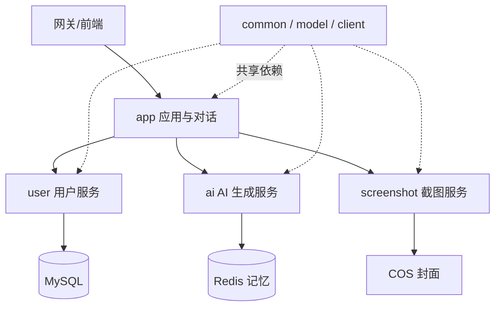

**企业落地**：这是「微服务骨架」——模块、依赖、Dubbo/Nacos 配置已就位，但并非所有业务都已完整迁移；网关（Higress）属于规划。拆分的目的不是"看起来架构先进"，而是独立部署、独立扩缩容、故障隔离；团队规模不够时，模块化单体往往比微服务更划算。

---

## 12063. 描述前端的核心业务流程，以及如何实现？

`中等` `前端` `编程导航`

**推荐答案**

主流程是：首页浏览/创建应用 → 对话页用 SSE 实时接收 AI 生成 → iframe 预览 → 部署拿公开链接 → 可视化选中元素发起修改 → 管理端维护应用/对话/用户。

1. **首页 `HomePage`**：应用卡片列表（封面、作者、查看对话/查看作品），创建应用后带着初始需求跳到对话页。
2. **对话页 `AppChatPage`（核心）**：进入时游标分页加载历史；发送需求后建立 `EventSource` 接收 SSE；右侧 iframe 实时预览；部署后弹 `DeploySuccessModal` 展示公开 URL。
3. **可视化编辑**：开启后向 iframe 注入脚本，点击元素拿到选择器与内容，拼进下一条消息，仍走同一条生成链路。
4. **应用编辑 `AppEditPage`**：修改名称、封面等基础信息；管理端 `AppManagePage / ChatManagePage / UserManagePage` 仅管理员可见。
5. **技术栈**：Vue 3 + TypeScript + Ant Design Vue + Pinia + Vue Router + Axios + EventSource + markdown-it/highlight.js。
6. **实现要点**：`useLoginUserStore` 管登录用户；`request.ts` 统一 baseURL、`withCredentials` 与错误处理；`access.ts` 做路由守卫；预览 URL 由 `getStaticPreviewUrl(type, appId)` 拼出。

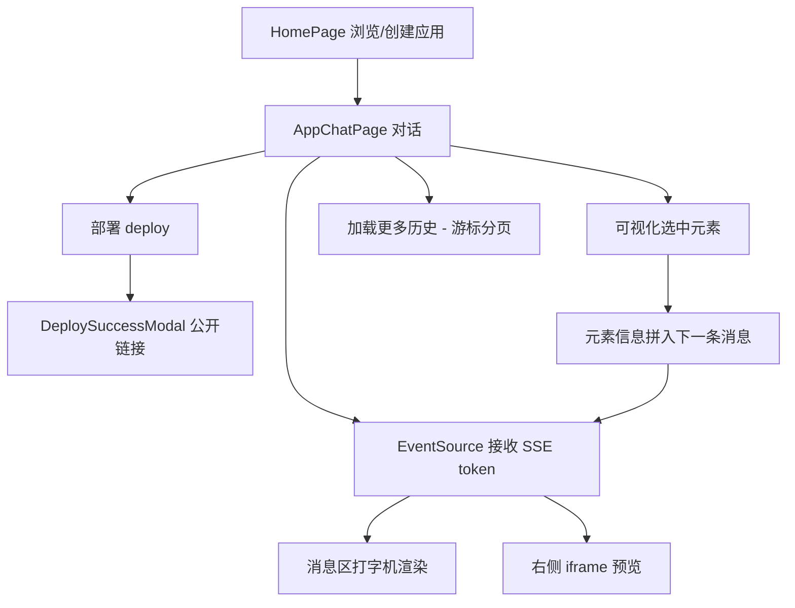

**企业落地**：当前是"页面内聚合逻辑"，企业会拆成 composables/store/服务层，页面只做编排；SSE 用 GET + URL 参数，消息长度受限，企业常改 `POST + fetch ReadableStream`；前端权限只是体验，真正的权限必须后端校验。

---

## 12064. 前端如何处理与后端的 SSE 流式通信，并实时展示 AI 的打字机效果？

`中等` `前端` `编程导航`

**推荐答案**

用 `EventSource` 建立长连接，`onmessage` 里 `JSON.parse(event.data)` 取 `d` 字段，把片段累加到当前 AI 消息并滚动到底部；收到 `done` 关闭连接并延迟刷新预览，收到 `business-error` 展示业务错误。

1. **建立连接**：`new EventSource(url, { withCredentials: true })`，URL 上带 `appId` 和 `message`；`withCredentials` 保证跨端口开发时也能携带 Session。
2. **解析增量**：后端每个事件是 `{"d": "chunk"}`，前端只取 `d` 累加到 `fullContent`，再赋给当前 AI 消息的 `content`，Vue 响应式自动重渲染。
3. **打字机效果的来源**：不是前端定时器伪造，而是模型 token 真实逐段到达；每来一段更新一次响应式变量，视觉上就是"逐字出现"。
4. **结束处理**：`done` 事件里关闭连接，延迟约 1 秒再刷新应用信息和 iframe，等后端落盘/Vue 构建完成，避免预览 404。
5. **错误处理**：`business-error` 展示后端返回的业务错误；`onerror` 要区分"正常关闭"和"真实错误"，否则正常结束也会弹错误提示。
6. **协议细节**：用 JSON 包装而不是直接写文本，是因为代码里的 `\n` 会破坏 SSE 的"行"语义，序列化后换行变成转义字符，传输才安全。

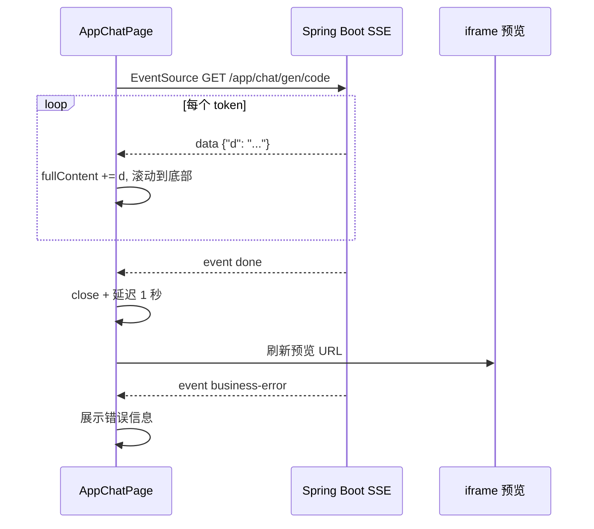

**企业落地**：`EventSource` 只支持 GET、不能自定义 Header，长需求放 URL 会超长，企业常用 `fetch + ReadableStream` 自建 SSE 客户端；要补心跳、断线重连、`Last-Event-ID` 续传；每个 token 都触发一次 Markdown 全量重渲染会卡，长文本要用 `requestAnimationFrame` 批量更新或增量解析。

---

## 12065. 如何实现对生成后网站的实时预览？

`中等` `前端` `编程导航`

**推荐答案**

对话页右侧放一个 `iframe`，`src` 指向后端静态资源接口 `/api/static/{codeType}_{appId}/`；Vue 工程指向 `dist/index.html`，生成完成后再刷新 URL。

1. **地址规则**：HTML/多文件是 `${API_BASE_URL}/static/${codeGenType}_${appId}/`；Vue 是 `${API_BASE_URL}/static/vue_project_${appId}/dist/index.html`。
2. **后端映射**：`StaticResourceController` 把 URL 剩余路径拼到 `CODE_OUTPUT_ROOT_DIR`，目录不带斜杠时 301 到带斜杠，保证相对路径资源能正确解析。
3. **默认页与类型**：`/` 默认返回 `index.html`；按扩展名设置 `Content-Type`（html/css/js/png/jpg），浏览器才能正确渲染。
4. **为什么用 iframe**：生成的页面有自己的 HTML/CSS/JS，直接塞进宿主页面会污染样式和全局变量；iframe 天然隔离 DOM、CSS、JS 作用域。
5. **同源的必要性**：可视化编辑要往 iframe 注入脚本、读 DOM、`postMessage`，跨域会被浏览器拦截，所以预览必须和后端同源。
6. **实时性的边界**：生成过程中文件可能还没写完，iframe 会 404；`done` 后延迟刷新是"够用"的方案，更实时需要后端推送文件变更事件。

```mermaid
flowchart TD
    A[生成完成落盘 type_appId] --> B{生成类型}
    B -->|HTML/多文件| C[/api/static/type_appId/]
    B -->|Vue| D[/api/static/vue_project_appId/dist/index.html]
    C --> E[StaticResourceController 读文件]
    D --> E
    E --> F[Content-Type + 301 斜杠 + 默认 index.html]
    F --> G[iframe 渲染]
    G --> H[可视化编辑注入脚本读取 DOM]
```

**企业落地**：同源是双刃剑：可注入脚本，但生成页面也能访问宿主 Cookie，存在安全风险；生产应把用户生成内容放到独立沙箱域名，加 CSP 与 iframe `sandbox` 属性；文件多时 Spring Boot 静态服务性能有限，企业会用 Nginx/对象存储 + 短期签名 URL。

---

## 12066. 实现对话历史时，前端如何配合后端游标分页？

`中等` `前端` `编程导航`

**推荐答案**

前端维护 `lastCreateTime` 游标：首次请求不带游标取最近 10 条；点"加载更多"把游标传回，拿到更早的 10 条后 `unshift` 到消息列表头部，并用"返回条数 === 10"判断是否还有更多。

1. **首次加载**：`params = { appId, pageSize: 10 }`，后端按 `createTime` 倒序返回最近一页。
2. **加载更多**：带上 `lastCreateTime`，后端用 `lt(createTime, lastCreateTime)` 查更早的数据，避免重复。
3. **顺序处理**：后端是倒序，前端先 `.reverse()` 成正序，再用 `unshift(...historyMessages)` 插到列表头部，保证"老消息在上"。
4. **游标更新**：取本页最后一条（最老）的 `createTime` 作为下一页游标。
5. **是否还有更多**：不查总数，只用 `records.length === 10` 判断满页；满页就可能还有，不满页一定到底。
6. **后端 SQL**：`eq(appId).lt(createTime, lastCreateTime).orderBy(createTime, false).limit(1, pageSize)`，配合 `(appId, createTime)` 联合索引，避免深分页 `OFFSET` 越翻越慢。
7. **已知问题**：如果同一毫秒有多条消息，仅用时间做游标可能漏数据或重复，更严谨的做法是用 `(createTime, id)` 组合游标。

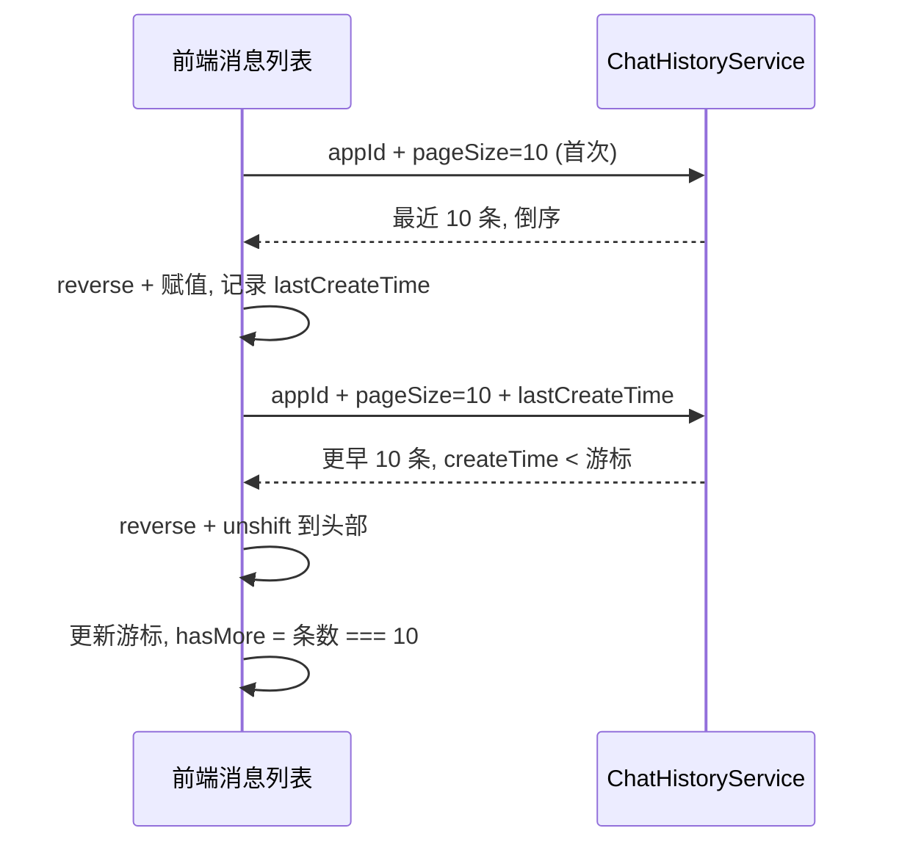

**企业落地**：游标分页适合"信息流/聊天记录"这种持续写入、不能接受数据漂移的场景；企业会用 `(createTime, id)` 或雪花 ID 做稳定游标，并给查询加覆盖索引；如果产品需要"跳到第 N 页"，再单独提供总数或分段缓存。

---

## 12067. 可视化编辑时，前端如何捕获并传递 iframe 内的用户点击事件？

`中等` `前端` `编程导航`

**推荐答案**

利用"预览页与宿主同源"，向 iframe 注入一段脚本；脚本在 `document.body` 上用**捕获阶段**监听 `mouseover / mouseout / click`，点击时 `preventDefault + stopPropagation`，生成元素信息后通过 `window.parent.postMessage` 发给父页面。

1. **注入脚本**：`enableEditMode()` 后延时调用 `injectEditScript()`，通过 `iframe.contentDocument` 创建 `<script id="visual-edit-script">` 插入 `head`。
2. **避免重复注入**：已存在脚本时不再插入，只发 `TOGGLE_EDIT_MODE` 消息切换开关，防止重复绑定监听器。
3. **捕获阶段监听**：`addEventListener('mouseover', handler, true)` 第三个参数 `true` 表示捕获阶段，先于页面自身的点击逻辑执行。
4. **阻止默认行为**：`clickHandler` 里 `event.preventDefault()` 阻止链接跳转/表单提交，`stopPropagation()` 阻止页面业务逻辑，避免"点一下跳走了"。
5. **视觉反馈**：悬浮加 `.edit-hover` 虚线框，选中加 `.edit-selected` 绿框，让用户知道自己选的是哪个元素。
6. **发送给父页面**：`window.parent.postMessage({ type: 'ELEMENT_SELECTED', data: { elementInfo } }, '*')`，父页面 `handleIframeMessage` 解析后保存 `selectedElement`。
7. **前提与风险**：必须同源，跨域时 `contentDocument` 不可访问；`postMessage('*')` 没有来源校验；Shadow DOM、嵌套 iframe、Canvas 内容都捕获不到。

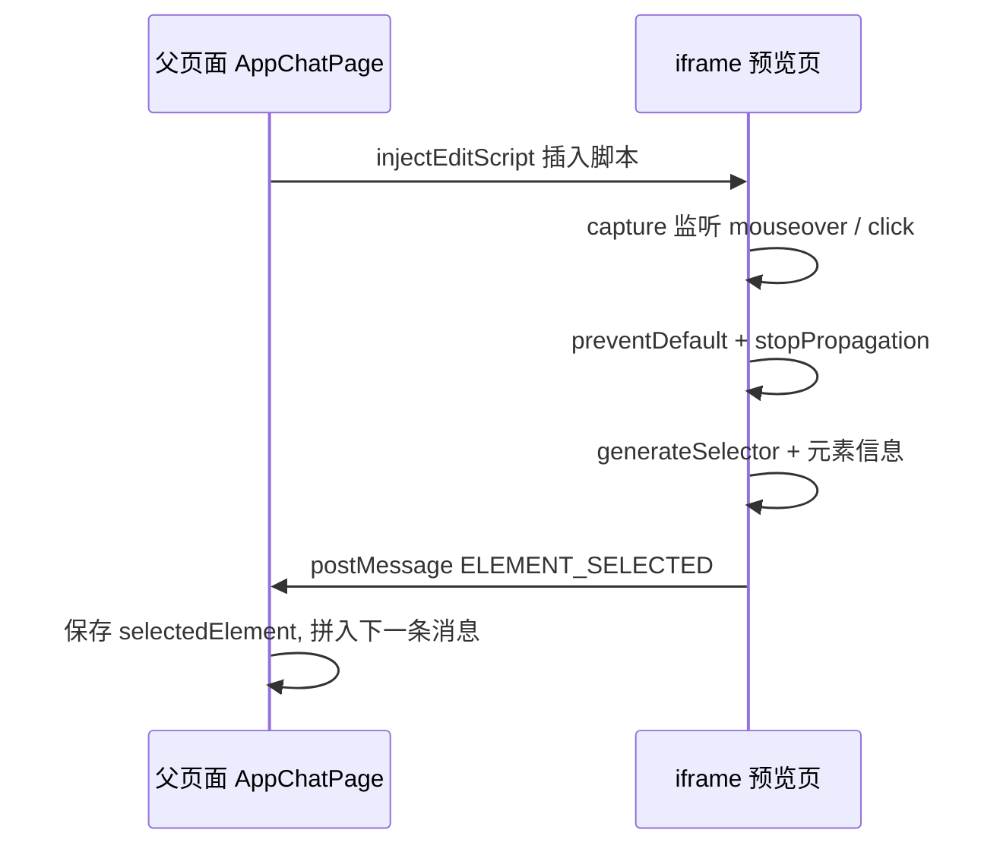

**企业落地**：更安全的做法是生成页面注入"编辑器 SDK"，通过 `postMessage` 双向通信并校验 `event.origin`；跨域预览用独立沙箱域名 + `sandbox` 属性 + CSP；复杂页面（Shadow DOM/Canvas）需要专门的选中方案，不能只靠普通事件监听。

---

## 12068. 用户选中元素后，前端如何生成稳定且唯一的选择器？

`中等` `前端` `编程导航`

**推荐答案**

从选中元素向上走到 `body`，优先用 `#id` 直接定位并停止；否则用「标签 + 过滤后的 class + `:nth-child(n)`」逐级拼接，最后用 `>` 连成 CSS 选择器，并附带 `pagePath` 定位页面。

1. **id 优先**：命中 `current.id` 就把 `#id` 加进路径并 `break`，id 通常唯一，路径最短、最稳定。
2. **class 过滤**：`className.split(' ').filter(c => c && !c.startsWith('edit-'))`，必须排除编辑器自己加的 `.edit-hover / .edit-selected`，否则选择器会随编辑状态变化。
3. **位置兜底**：无 id/class 时用 `Array.from(parent.children).indexOf(current) + 1` 生成 `:nth-child(n)`，保证唯一性。
4. **逐级拼接**：每级 `unshift` 到路径头部，最终 `path.join(' > ')` 得到从 body 到目标的完整选择器。
5. **页面定位**：`pagePath = location.search + location.hash`，多页/ Vue 路由场景下用于区分"同一个选择器出现在不同页面"。
6. **稳定性局限**：CSS Modules/随机哈希 class 会让选择器失效；`:nth-child` 对结构变化敏感，加一个兄弟节点就错位；Shadow DOM 内元素普通 CSS 选择器无法穿透。

```mermaid
flowchart TD
    A[选中元素] --> B{有 id?}
    B -->|是| C[tag#id, 加入路径并停止]
    B -->|否| D[tag + 过滤 edit- 后的 class]
    D --> E[+ :nth-child(n)]
    E --> F[unshift 到路径头部]
    F --> G{到达 body?}
    G -->|否| B
    G -->|是| H[join ' > ']
    C --> H
    H --> I[附带 pagePath 一起发送]
```

**企业落地**：低代码/可视化编辑常用"稳定属性优先"：`data-testid`、`data-id`、业务 id、ARIA 属性；更稳的做法是给生成页面注入 `data-editor-id`，用唯一 ID 定位；选择器只负责"定位"，真正修改应走 AST/codemod，避免文本替换误伤。

---

## 12069. 哪些部分被抽象成了可复用的 Vue 组件？开发组件的主要思路？

`简单` `前端` `编程导航`

**推荐答案**

应用卡片、详情弹窗、部署成功弹窗、全局头尾、用户信息、Markdown 渲染器被抽成组件；思路是「单一职责 + props 入 / emit 出 + 插槽扩展 + 不耦合业务状态」。

1. **`AppCard.vue`**：首页/我的应用/精选应用复用，`props: app, featured`，`emits: view-chat, view-work`，组件本身不请求数据、不做路由跳转。
2. **`AppDetailModal.vue`**：对话页与管理页复用的受控弹窗，靠 `visible + app` 控制。
3. **`DeploySuccessModal.vue`**：展示部署 URL 与复制按钮，属于纯展示组件。
4. **`GlobalHeader.vue / GlobalFooter.vue`**：全站布局与导航，登录态由 store 提供，组件只负责展示。
5. **`UserInfo.vue`**：头像、昵称、菜单，头部复用。
6. **`MarkdownRenderer.vue`**：接收 `content` prop，内部完成 Markdown 解析与代码高亮，AI 消息处统一使用。

以 `AppCard` 为例的设计思路：单一职责（只展示一个应用卡片）；数据向下（props 传 `app / featured`，不依赖全局 store）；事件向上（`emit('view-chat', app.id)`，由父页面决定跳转还是弹窗）；样式内聚（`scoped` + `featured` 变体）；需要扩展时加 `slot`，而不是继续堆 props。

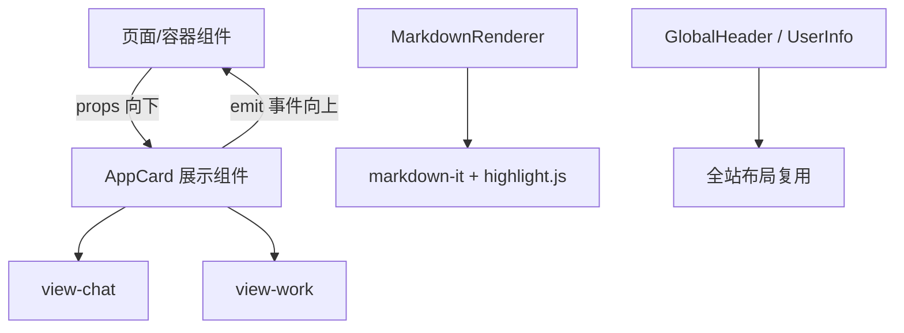

**企业落地**：组件不是越抽越好，只在"多处复用 + 有稳定边界"时抽；展示组件（哑组件）与容器组件分离，便于测试与复用；设计系统层面要统一 props 命名、事件命名、尺寸与主题变量；过度抽象会导致"配置爆炸"，比重复更难维护。

---

## 12070. 如何设计前端路由？管理员页面在前端层面做了哪些访问控制？

`中等` `前端` `编程导航`

**推荐答案**

用 `createWebHistory` 定义路由，`access.ts` 注册全局 `beforeEach` 守卫：先拉取登录用户，再按 `path.startsWith('/admin')` 校验管理员角色，不满足跳登录或 403。

1. **路由模式**：`createWebHistory()` 使用 history 模式，URL 干净，但需要 Nginx `try_files` 回退到 `index.html`，否则刷新子路由 404。
2. **路由表**：`/`、`/app/:id`（对话）、`/app/edit/:id`、`/admin/app`、`/admin/chat`、`/admin/user`、`/login`、`/register`。
3. **先拉用户再判断**：刷新页面后 Pinia store 是空的，守卫里必须调用 `fetchLoginUser()` 请求 `/user/get/login`，否则会把已登录用户误判成未登录。
4. **管理员校验**：`to.path.startsWith('/admin')` 时判断 `loginUser.userRole !== 'admin'`。
5. **分流**：未登录 → `/login?redirect=原路径`，登录后回到原页面；已登录但非管理员 → `/403`。
6. **真正的防线在后端**：前端守卫只决定"页面能不能进"，接口必须由后端 `@AuthCheck` 校验，否则用户直接调接口就能越权。

```mermaid
flowchart TD
    A[路由跳转] --> B[beforeEach 守卫]
    B --> C{store 有登录用户?}
    C -->|否| D[fetchLoginUser]
    C -->|是| E{path 以 /admin 开头?}
    D --> E
    E -->|否| F[放行]
    E -->|是| G{userRole === admin?}
    G -->|是| F
    G -->|否| H{已登录?}
    H -->|是| I[/403]
    H -->|否| J[/login?redirect=...]
```

**企业落地**：企业常用"动态路由 + 权限码"：登录后按权限生成可访问路由，菜单与路由同源；路由用 `() => import(...)` 懒加载按页拆包；前端权限永远不能替代后端鉴权，越权接口必须后端拦截并记录审计日志。

---

## 12071. AI 返回的 Markdown 包含代码块，前端如何解析并实现代码高亮？

`简单` `前端` `编程导航`

**推荐答案**

用 `markdown-it` 把 Markdown 渲染成 HTML，`highlight` 回调里用 `highlight.js` 按语言高亮代码块，再用 `v-html` 插入页面。

1. **初始化配置**：`new MarkdownIt({ html: true, linkify: true, breaks: true, highlight })`；`breaks: true` 让单个换行也生效，符合聊天场景。
2. **高亮回调**：`hljs.getLanguage(lang)` 判断语言是否支持，支持则 `hljs.highlight(str, { language: lang }).value`，包进 `<pre><code class="hljs">`。
3. **失败兜底**：语言不支持或高亮抛错时，用 `md.utils.escapeHtml(str)` 转义后原样展示，保证"代码里的 HTML 不会被执行"。
4. **渲染方式**：`computed(() => md.render(props.content))` 得到 HTML，模板里 `v-html` 插入；样式引入 highlight.js 主题 CSS。
5. **真实风险**：`html: true` 允许 Markdown 里的原始 HTML 直接渲染，**没有 DOMPurify 等清洗**，AI 输出被污染时存在 XSS 风险。
6. **性能问题**：每来一个 token 都重新 `md.render` 整段内容，长文本会重复解析；应做增量渲染或按帧合并。

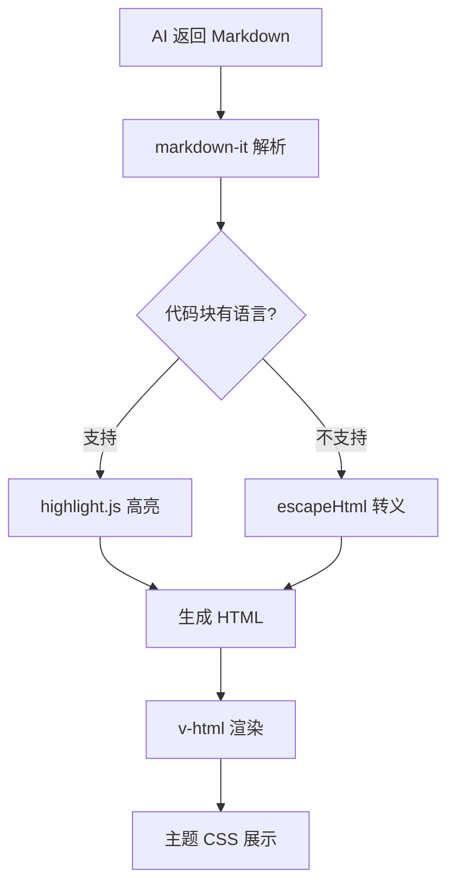

**企业落地**：必须做 HTML 清洗（DOMPurify）+ CSP，尤其是 AI 生成内容；增量渲染只解析新增片段，或对已渲染结果做缓存；代码高亮可以换 Shiki（更准但更重）或服务端高亮；对外分享场景应禁用 `html` 或只允许白名单标签。

---

## 12072. 从多端性能优化角度看，项目还有哪些可以改进的地方？

`中等` `前端` `编程导航`

**推荐答案**

主要在五块：首屏包体、流式渲染、长列表、图片与缓存、网络与部署。对应做法是路由懒加载、token 批量渲染、消息虚拟列表、图片懒加载/CDN、gzip/brotli 与缓存策略。

1. **首屏包体**：路由多为静态 import、Ant Design 全量引入 → 改路由懒加载、组件按需引入、`manualChunks` 拆 vendor。
2. **流式渲染**：每个 token 都改一次响应式变量并全量重渲染 Markdown → 用 `requestAnimationFrame` 批量更新、增量解析、节流。
3. **长列表**：历史消息全量 DOM → 虚拟列表（vue-virtual-scroller）、分页 + 回收。
4. **图片**：封面原图直出 → 懒加载、响应式尺寸、WebP/AVIF、CDN。
5. **网络与缓存**：无 gzip/brotli、静态资源无长缓存 → Nginx 压缩、HTTP/2、文件名 hash + `Cache-Control: immutable`。
6. **计算与移动端**：Markdown/高亮在主线程、布局偏桌面 → Web Worker 解析、响应式断点、抽屉式侧栏、触控优化。
7. **监控**：目前没有前端性能指标 → 上报 Web Vitals（LCP/INP/CLS），用数据定位瓶颈。

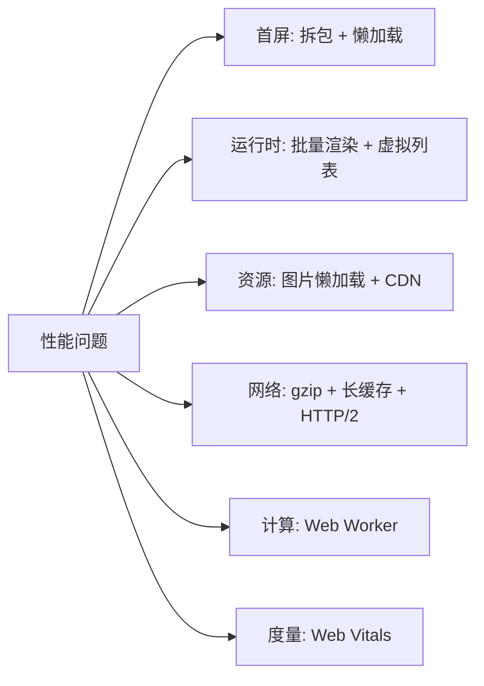

**企业落地**：优化要先用数据定位（Lighthouse、RUM），不要盲目优化；首屏与运行时是不同问题：首屏靠拆包/CDN，运行时靠减少重渲染与长任务；低端机与弱网要单独测，桌面流畅不代表移动端可用；iframe 预览要加 `loading="lazy"`，切换应用时销毁旧 iframe，避免多个页面同时运行。

---

## 12073. 如何实现前后端项目的部署上线？请介绍完整流程。

`中等` `架构` `编程导航`

**推荐答案**

后端打 jar 跑在服务器（JDK 21 + MySQL + Redis），前端 `npm run build` 出静态文件交给 Nginx，Nginx 同时反代 `/api` 并托管 `code_deploy` 部署产物，最后配域名/HTTPS/进程守护。

1. **环境准备**：安装 JDK 21、MySQL 8、Redis、Nginx、Node；执行 `sql/create_table.sql` 建库建表，初始化管理员。
2. **后端构建与启动**：`mvn clean package -DskipTests`，上传 jar，配置 `application-prod.yml`（数据库/Redis/模型 Key/COS），用 systemd 或 Docker 启动，端口 8123，`context-path /api`，验证 `/api/health/`。
3. **前端构建**：`npm install && npm run build`，把 `dist/` 上传到 Nginx 静态目录。
4. **Nginx 配置**：`location /` 指向前端 dist 并 `try_files` 回退；`location /api/` 反代 `127.0.0.1:8123/api/`；SSE 关缓冲、超时放大；`code_deploy` 作为部署产物根目录。
5. **部署能力**：应用内 `deployApp` 把 `code_output` 拷到 `code_deploy/{deployKey}`，返回公开 URL，异步生成封面。
6. **验证**：注册登录、三类生成、预览、部署、下载、截图；确认 SSE 不缓冲、静态资源 200、部署 URL 可访问。
7. **运维**：日志落盘与切割、Prometheus 抓取、Grafana 面板、MySQL 备份、Redis 持久化、COS 备份。

```nginx
server {
    listen 80;
    server_name code.example.com;
    root /opt/yu-ai-code/frontend-dist;

    location / { try_files $uri $uri/ /index.html; }

    location /api/ {
        proxy_pass http://127.0.0.1:8123/api/;
        proxy_http_version 1.1;
        proxy_buffering off;
        proxy_read_timeout 3600s;
    }

    location /deploy/ {
        alias /opt/yu-ai-code/tmp/code_deploy/;
    }
}
```

```mermaid
flowchart TD
    A[开发者] --> B[后端 jar]
    A --> C[前端 dist]
    B --> D[systemd / Docker :8123]
    C --> E[Nginx 静态托管]
    D --> F[/api 反向代理]
    E --> G[浏览器访问]
    F --> G
    D --> H[code_deploy 部署产物]
    H --> I[Nginx 托管 /deployKey/]
```

**企业落地**：单机部署简单但不具备高可用；企业用 Docker Compose/K8s + 多副本 + 负载均衡；配置与密钥用环境变量/配置中心，禁止明文入库；上线要有 CI/CD（构建、测试、镜像、灰度、回滚）与健康检查；生成产物属于用户数据，要独立存储并做备份与配额。

---

## 12074. 从哪些方面进行了系统优化？请举例说明。

`中等` `综合` `编程导航`

**推荐答案**

从模型成本、响应体验、并发与异步、缓存、数据库、稳定性、可观测七个方面优化；典型例子是模型分级路由、SSE 流式、异步截图、Caffeine 缓存、游标分页、限流与指标监控。

1. **模型成本**：分类/路由用 `qwen-turbo`（`max-tokens: 100`），生成用 `deepseek-chat`（8192），Vue 复杂生成用 `deepseek-reasoner`（32768、temperature 0.1），避免所有任务都上最贵的模型。
2. **响应体验**：SSE 逐 token 输出，用户不用等整段生成完才看到内容，首字延迟即反馈。
3. **并发与异步**：截图用 `Thread.startVirtualThread` 异步；Vue 构建独立执行并设超时（npm install 300s、build 180s，超时 `destroyForcibly`）。
4. **缓存**：Caffeine 缓存 AI 服务实例（1000 / 30 分钟 / 10 分钟），Redis 缓存精选应用等读多写少数据。
5. **数据库**：游标分页替代 `OFFSET`，`(appId, createTime)` 联合索引支撑查询，避免深分页慢和数据漂移。
6. **并发编排**：LangGraph4j 四类图片收集分支并行 + 独立线程池，缩短前置耗时。
7. **稳定性与可观测**：Redisson 限流、`maxSequentialToolsInvocations(20)`、工具幻觉自愈、输入/输出护轨、`ChatModelListener` + Micrometer + Prometheus。

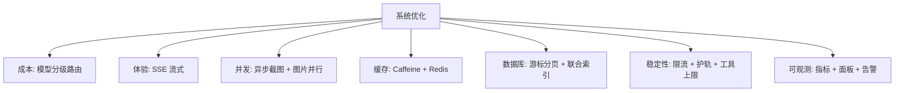

**企业落地**：优化要按"用户感知 / 成本 / 稳定性"排序，先测量再优化；每个优化都要有回滚方案与监控指标；可继续做的方向：长会话记忆摘要、异步构建 + 状态推送、工具调用全链路追踪、多级缓存与 CDN、数据库冷热分离。

---

## 12075. 如果要为平台增加多人实时协作编辑同一个应用，你会怎么做？

`困难` `综合` `编程导航`

**推荐答案**

核心是「实时同步 + 冲突消解 + 权限与锁」：前端用 CRDT（Yjs/Automerge）或 OT 做文本协同，后端用 WebSocket 房间 + 持久化快照，AI 生成/部署等重操作加分布式锁与版本控制。

1. **实时通道**：WebSocket（双向、低延迟），按 `appId` 建房间；服务端用 Redis Pub/Sub 或独立协同服务（如 y-websocket）广播变更。
2. **冲突消解**：优先 CRDT（Yjs/Automerge），天然支持离线与并发合并；OT 需要中心服务器变换操作，实现复杂；简单场景可以退化为"同一文件悲观锁 + 版本号乐观锁"。
3. **状态模型**：把应用文件树映射成共享文档，每个文件一个 `Y.Text`，保存 `docId + version + snapshot`。
4. **在线状态**：presence（谁在线、光标位置、选中元素）、头像、颜色，提升协作体验。
5. **AI 协作**：AI 作为"参与者"写入变更，也必须走同一套 CRDT 操作；AI 长任务期间对文件加租约锁，避免覆盖人工修改。
6. **持久化与回放**：定期把 CRDT 快照落库/对象存储，操作日志用于回放与审计。
7. **权限与构建**：房间级角色（owner/editor/viewer）、敏感操作二次确认；部署/构建用分布式锁 + 队列串行化，避免多人同时触发。

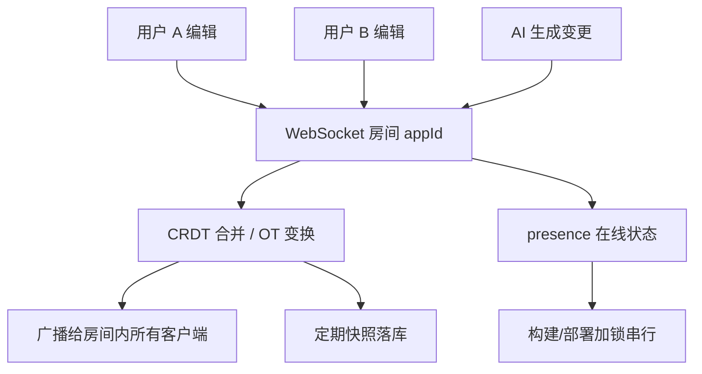

**企业落地**：协同编辑是"体验 + 一致性"的权衡，CRDT 体验好但存储/带宽成本高；代码协同比纯文本难，需要 AST 级合并、格式化冲突、构建冲突处理；AI 与多人协作必须设计"谁在什么时候能改"，否则会出现"AI 覆盖人工修改"。

---

## 12076. 项目大量使用 AI 辅助编程，你如何看待 Vibe Coding 开发模式？

`中等` `综合` `编程导航`

**推荐答案**

Vibe Coding 是"用自然语言驱动 AI 快速产出代码"的模式，能显著提速与降低样板成本，但必须配合人工评审、测试与安全审查；它是加速器，不是替代品。

1. **优点**：快速搭骨架、生成样板代码、补测试与文档；节省查 API、写重复 CRUD 的时间；帮助不熟悉的框架快速上手；适合探索性原型和一次性脚本。
2. **风险一：幻觉**：API 不存在、参数顺序错、配置项编造，编译或运行时才暴露。
3. **风险二：安全**：硬编码密钥、越权、注入漏洞，AI 不会主动考虑你的威胁模型。
4. **风险三：可维护性**：风格不一致、重复代码、隐式耦合，短期能跑、长期难改。
5. **风险四：理解缺失**：开发者说不清代码为什么这样写，线上出问题无法定位，这是最贵的成本。
6. **正确用法**：小步（一次一个函数/一个测试）、给足上下文与约束、编译/单测/静态扫描/Code Review 全过、合并进主干的代码必须有人能解释每一行。

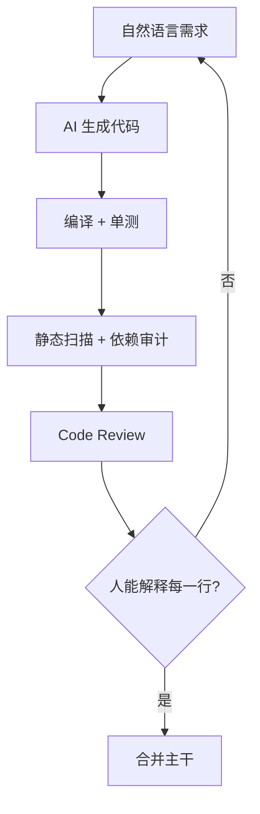

**企业落地**：企业通常允许"辅助编码"，但要求代码评审、许可证扫描、SAST、依赖审计；核心链路（支付、权限、数据）提高人工参与比例；度量"AI 生成占比 + 缺陷率 + 返工率"，而不是只看生成了多少行；面试表达要承认大量使用 AI，同时强调"我负责架构、关键实现、验证与兜底"。

---

## 12077. 你认为项目中最具技术挑战性的功能是哪一个？描述解决挑战的完整过程。

`困难` `综合` `编程导航`

**推荐答案**

最具挑战的是「Vue 工程生成」——它把流式输出、工具调用、文件隔离、构建校验串成一条长链路，任何一环不稳都会导致"用户以为成功、预览却 404"。

1. **挑战一：模型不会一次性输出完整工程**：必须让模型学会用工具逐个写文件，而不是指望一段文本里包含所有文件。
2. **挑战二：工具调用不稳定**：工具名幻觉、参数错误、重复调用、无限循环，必须逐项兜底。
3. **挑战三：文件安全**：模型可能给绝对路径或 `../` 越界，必须路径规范化与目录隔离。
4. **挑战四：流式与工具事件混合**：既要推 token，又要推"正在写哪个文件"，还要在结束后落盘/构建。
5. **挑战五：构建不确定**：`npm install/build` 可能超时、失败、产物缺失。
6. **挑战六：并发**：同一 appId 多请求共享记忆，上下文会串。

解决过程：① 用 `AiServices + TokenStream` 承载"文本 + 工具事件"；② 用 `@Tool / @P / @ToolMemoryId` 定义文件工具并注入 appId；③ 路径 `resolve + normalize + startsWith` 防穿越，失败返回字符串让模型自愈；④ `hallucinatedToolNameStrategy` 处理工具名幻觉；⑤ `maxSequentialToolsInvocations(20)` + `ExitTool` 防死循环；⑥ `Flux.create` 把回调桥接成 SSE；⑦ `onCompleteResponse` 后同步构建：超时强杀 + `dist` 存在性校验；⑧ Caffeine 缓存实例；⑨ 监控 token/耗时/错误。

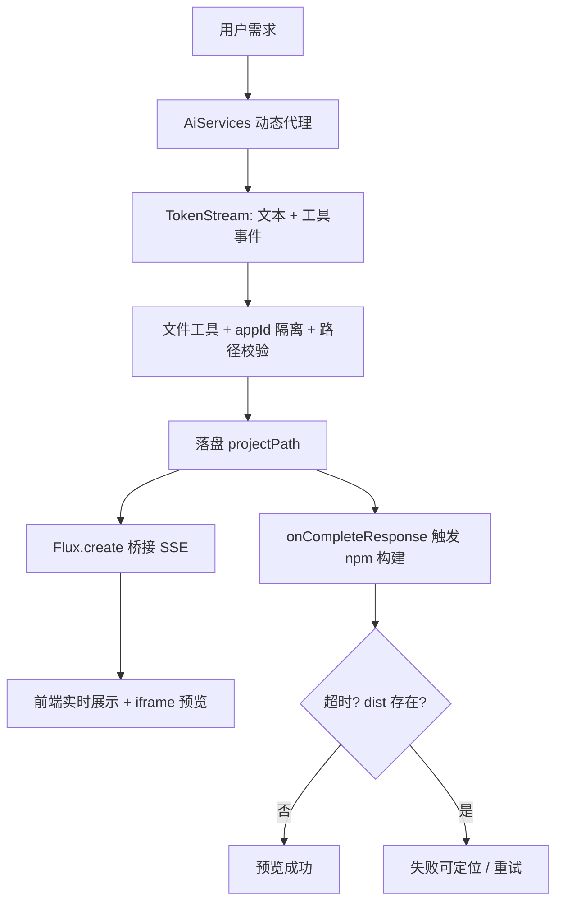

**踩过的坑**：在 `doOnNext` 里落盘会写出半截文件，改为 `doOnComplete`；只看构建退出码会漏掉 `dist` 不存在，补产物校验；固定 `sleep` 等渲染会白屏，改显式等待；同 appId 并发会记忆串扰，需要锁或隔离。

**企业落地**：这类长链路的稳定性靠"分段可观测 + 明确失败语义 + 幂等/重试"；生成类任务适合"异步任务 + 状态机"，而不是一个超长 HTTP 请求；技术挑战的价值在于"把不确定性收敛成可运营的流程"，而不是"一次生成成功"。

---

## 12078. 将项目从单体改造成微服务，有哪些好处？又有哪些问题？

`中等` `架构` `编程导航`

**推荐答案**

好处是独立部署/扩缩容、故障隔离、团队自治、技术异构；问题是分布式事务、网络延迟、运维复杂度、数据一致性、调试困难、成本上升。

1. **独立伸缩**：AI 生成 CPU/内存/并发高，可单独扩容 `ai`；截图可独立扩容，不拖累主应用。
2. **故障隔离**：截图服务挂了不影响生成主链路；某个服务 OOM 不会拖垮全站。
3. **独立发布**：改截图逻辑不用重启整个应用，发布风险面更小。
4. **技术异构与团队自治**：AI 服务可独立选模型/框架，团队按 user/app/ai/screenshot 分工。
5. **问题一：分布式事务**：创建应用 + 扣配额 + 生成记录跨服务，需 Saga、本地消息表、最终一致。
6. **问题二：网络与数据**：每次 Dubbo 调用都可能超时，每服务独立库导致跨库查询难，需要超时/重试/熔断、冗余字段、聚合服务。
7. **问题三：运维与调试**：多服务部署、注册中心、网关、链路追踪，一次请求跨多个服务，必须 traceId 全链路 + 日志聚合。

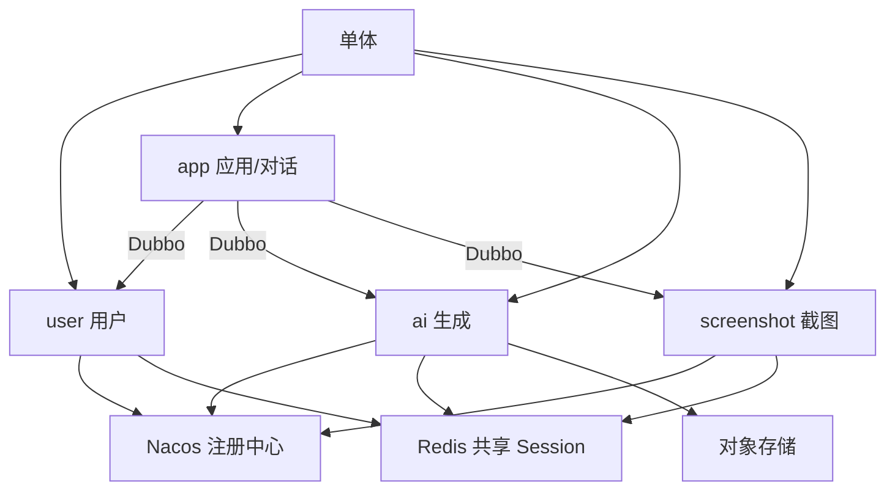

**企业落地**：不要"为了微服务而微服务"，先用模块化单体把边界理清；拆分顺序优先"变更频率高/资源需求差异大/故障影响大"的模块（如 AI、截图）；用绞杀者模式渐进迁移，保留单体兜底；微服务的前置条件是 CI/CD、监控、日志、链路追踪、配置中心必须先就位。

---

## 12079. 为什么选择 Higress 而不是 Spring Cloud Gateway 作为微服务网关？它在项目中有哪些作用？

`困难` `架构` `编程导航`

**推荐答案**

Higress 是基于 Envoy + Istio 的云原生网关，除了常规路由/鉴权，还内置 AI 网关能力（多模型代理、token 级限流、语义缓存、内容安全、协议适配）；Spring Cloud Gateway 更贴 Spring 生态，但缺少 AI 场景的专用能力。

1. **云原生与性能**：Higress 数据面基于 Envoy（C++），K8s Ingress/Gateway API 原生，高并发入口比 JVM 网关更轻。
2. **路由与安全**：按域名/路径/Header 路由，灰度、权重、镜像；JWT/OAuth、WAF、IP 黑白名单、TLS。
3. **AI 网关能力**：统一代理多家模型（OpenAI 兼容协议）、token 级限流/配额、语义缓存、内容安全、协议转换，这些是 AI 平台的核心诉求。
4. **长连接与流式**：SSE/流式响应支持成熟，适合代码生成这种几十秒的长连接。
5. **可扩展与可观测**：Wasm 插件（Go/Rust/C++）自定义鉴权/日志/变换；指标、访问日志、链路追踪集成。
6. **Spring Cloud Gateway 的特点**：Java/Spring 生态、Filter 编程模型简单、与 Nacos/Security 集成好；但 AI 专用能力要自己写 Filter，高并发下 JVM/GC 有开销，Wasm 生态弱。

```mermaid
flowchart TD
    A[客户端] --> B[Higress 网关]
    B -->|路由| C[user 服务]
    B -->|路由| D[app 服务]
    B -->|路由| E[ai 服务]
    B -->|路由| F[screenshot 服务]
    B --> G[鉴权 / 限流 / 灰度]
    B --> H[AI 网关: 多模型 / token 配额 / 语义缓存]
    C & D & E & F --> I[Nacos]
```

**企业落地**：已有 Spring Cloud 体系、团队 Java 为主，SCG 上手快、维护成本低；AI 平台、K8s 环境、需要模型治理，Higress 更合适；网关不是越早越好，单体阶段 Nginx 足够。需要如实说明：本项目微服务仓库只用了 Dubbo + Nacos，**Higress 配置不在代码中**，属于部署/基础设施规划；单体版本的网关能力由 Nginx + 应用内限流承担。

---

## 12080. 拆分微服务有哪些核心原则？请结合项目说明。

`中等` `架构` `编程导航`

**推荐答案**

按业务边界（DDD 限界上下文）拆、高内聚低耦合、数据私有、契约先行、独立部署、渐进演进；对应到项目就是 user/app/ai/screenshot 四个业务服务 + common/model/client 共享层。

1. **业务边界**：按"业务能力"而非技术分层拆，user（身份）、app（应用/对话）、ai（生成）、screenshot（截图）各自闭环。
2. **高内聚低耦合**：一个服务内的改动集中，服务间依赖少；ai 不依赖 app 的业务逻辑，只通过接口/消息交互。
3. **数据私有**：每个服务独占自己的库/表，不共享库；跨服务查询用冗余字段、聚合服务或 CDC。
4. **契约先行**：先定义 API/DTO 再实现，`yu-ai-code-client` 专门放 Dubbo 接口与 DTO。
5. **独立部署与伸缩**：每个模块独立 Spring Boot 应用，能单独构建、发布、回滚；ai/screenshot 按资源需求独立扩容。
6. **故障隔离**：一个服务挂了不拖垮全局，截图失败不影响生成。
7. **渐进演进**：绞杀者模式，先骨架再逐模块迁移，不一次性重写；共享基础设施用 Redis 存 Session、对象存储放文件。

```mermaid
flowchart TD
    A[业务边界] --> B[user]
    A --> C[app]
    A --> D[ai]
    A --> E[screenshot]
    B & C & D & E --> F[common / model / client]
    C --> G[Dubbo 契约调用]
    B & C --> H[Redis Session]
    D --> I[对象存储 / 记忆]
    J[网关] --> B & C & D & E
```

**企业落地**：微服务不是架构目标，而是"组织与伸缩"的手段；拆得越细，网络调用、数据一致性、运维成本越高；团队规模 < 2 个 pizza team 时，模块化单体往往更划算；先拆"资源需求差异大"（AI/截图）或"故障影响大"的模块；成功的拆分通常伴随 CI/CD、契约测试、可观测性、配置中心、网关的同步建设。

---
